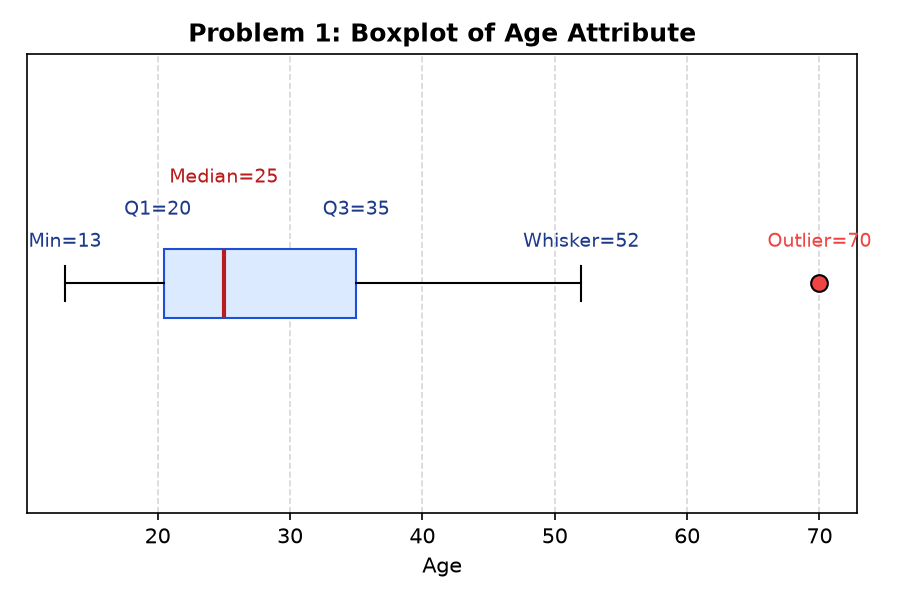
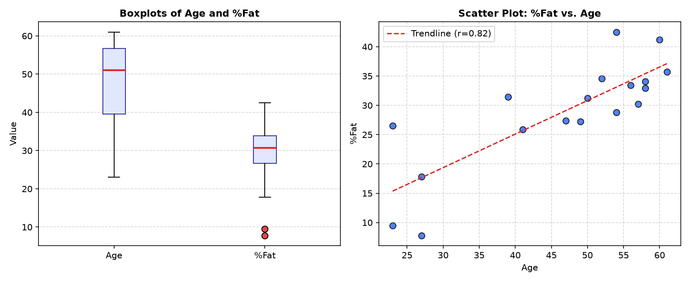
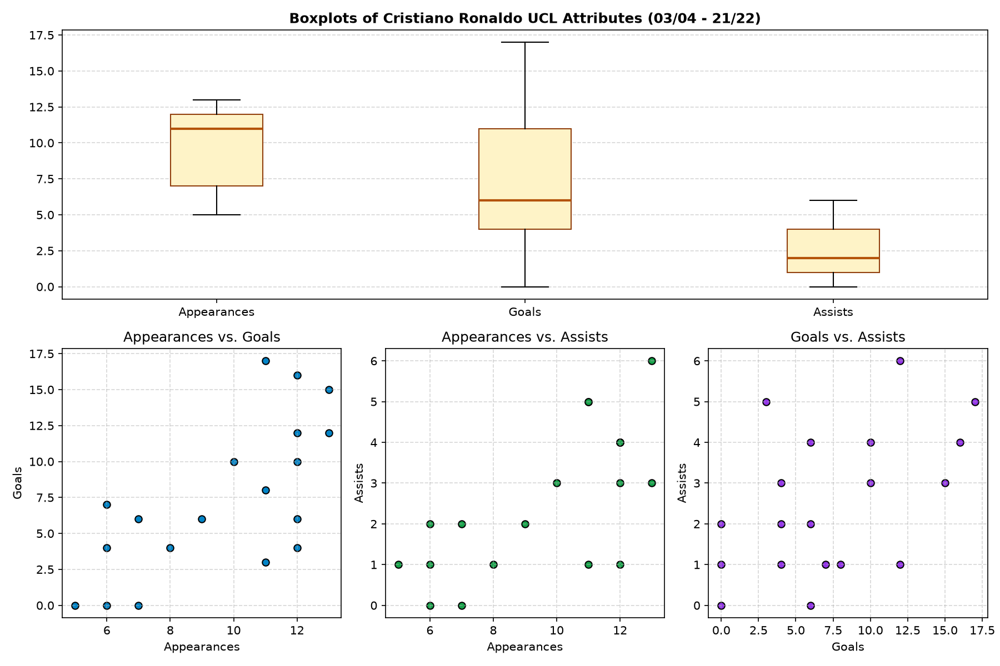

# Problem Set 1: Data Understanding

Solutions and detailed step-by-step calculations for Problem Set 1 (Data Understanding).

---

## Problem 1: Univariate Data Analysis on Age

**Dataset (in increasing order):**
$$\{13, 15, 16, 16, 19, 20, 20, 21, 22, 22, 25, 25, 25, 25, 30, 33, 33, 35, 35, 35, 35, 36, 40, 45, 46, 52, 70\}$$
- Sample size: $n = 27$
- Sum of values: $\sum_{i=1}^{27} x_i = 809$
- Sum of squared values: $\sum_{i=1}^{27} x_i^2 = 28,597$

### a. Mean and Median
1. **Mean ($\bar{x}$):**
   $$\bar{x} = \frac{1}{n} \sum_{i=1}^{n} x_i = \frac{809}{27} \approx 29.9630 \approx 29.96$$

2. **Median:**
   Since $n = 27$ (odd), the median is the $\left(\frac{n+1}{2}\right)$-th value, which is the $14$-th value in sorted order:
   $$\text{Median} = x_{(14)} = 25$$

---

### b. Mode and Modality
- Frequency table of values occurring more than once:
  - $16$: 2 times
  - $20$: 2 times
  - $22$: 2 times
  - **$25$**: **4 times**
  - $33$: 2 times
  - **$35$**: **4 times**
- The maximum frequency is $4$, which occurs at both **$25$** and **$35$**.
- **Conclusion:** The data has two modes: **$25$** and **$35$**. The distribution is **bimodal**.

---

### c. Midrange
$$\text{Midrange} = \frac{\min + \max}{2} = \frac{13 + 70}{2} = \frac{83}{2} = 41.5$$

---

### d. First Quartile ($Q_1$) and Third Quartile ($Q_3$)
Using the standard textbook method (Tukey's hinges / median of lower and upper halves):
- The median ($25$) divides the 27 observations into two subsets of $13$ values each (excluding the median itself):
  - **Lower half ($13$ values):** $\{13, 15, 16, 16, 19, 20, 20, 21, 22, 22, 25, 25, 25\}$
  - **Upper half ($13$ values):** $\{30, 33, 33, 35, 35, 35, 35, 36, 40, 45, 46, 52, 70\}$
- **First Quartile ($Q_1$):** Median of the lower half ($7$-th value):
  $$Q_1 = x_{(7)} = 20$$
- **Third Quartile ($Q_3$):** Median of the upper half ($7$-th value of upper half, or $21$-st value overall):
  $$Q_3 = x_{(21)} = 35$$

---

### e. Five-Number Summary
1. **Minimum:** $13$
2. **First Quartile ($Q_1$):** $20$
3. **Median:** $25$
4. **Third Quartile ($Q_3$):** $35$
5. **Maximum:** $70$

$$\text{Five-number summary} = [13, \, 20, \, 25, \, 35, \, 70]$$

---

### f. Boxplot of the Data
- Interquartile Range ($IQR$):
  $$IQR = Q_3 - Q_1 = 35 - 20 = 15$$
- Outlier detection fences ($1.5 \times IQR = 1.5 \times 15 = 22.5$):
  - Lower fence: $Q_1 - 22.5 = 20 - 22.5 = -2.5$
  - Upper fence: $Q_3 + 22.5 = 35 + 22.5 = 57.5$
- **Whiskers:**
  - Lower whisker extends to lowest data point within fence: **$13$**
  - Upper whisker extends to highest data point within fence: **$52$**
- **Outliers:** The value **$70$** exceeds $57.5$, so it is plotted as an individual outlier.

---

### g. Variance and Standard Deviation
Sum of squared deviations:
$$\sum_{i=1}^{n} (x_i - \bar{x})^2 = \sum x_i^2 - \frac{(\sum x_i)^2}{n} = 28,597 - \frac{809^2}{27} \approx 4,354.9630$$

1. **Sample Variance and Standard Deviation ($n-1 = 26$):**
   $$s^2 = \frac{4,354.9630}{26} \approx 167.4986 \approx 167.50$$
   $$s = \sqrt{167.4986} \approx 12.9421 \approx 12.94$$

2. **Population Variance and Standard Deviation ($N = 27$):**
   $$\sigma^2 = \frac{4,354.9630}{27} \approx 161.2949 \approx 161.29$$
   $$\sigma = \sqrt{161.2949} \approx 12.7002 \approx 12.70$$

---
---

## Problem 2: Bivariate Analysis on Age and %Fat

**Dataset ($n = 18$ adults):**

| Index | Age ($X$) | %Fat ($Y$) | Index | Age ($X$) | %Fat ($Y$) |
|:-----:|:---------:|:----------:|:-----:|:---------:|:----------:|
| 1     | 23        | 9.5        | 10    | 52        | 34.6       |
| 2     | 23        | 26.5       | 11    | 54        | 42.5       |
| 3     | 27        | 7.8        | 12    | 54        | 28.8       |
| 4     | 27        | 17.8       | 13    | 56        | 33.4       |
| 5     | 39        | 31.4       | 14    | 57        | 30.2       |
| 6     | 41        | 25.9       | 15    | 58        | 34.1       |
| 7     | 47        | 27.4       | 16    | 58        | 32.9       |
| 8     | 49        | 27.2       | 17    | 60        | 41.2       |
| 9     | 50        | 31.2       | 18    | 61        | 35.7       |

---

### a. Mean, Median, Variance, and Standard Deviation

#### For Age ($X$):
- $\sum X = 836$, $\sum X^2 = 41,792$
- **Mean:** $\bar{X} = \frac{836}{18} \approx 46.4444 \approx 46.44$
- **Median:** $\frac{50 + 52}{2} = 51.0$
- **Sample Variance:** $s_X^2 = \frac{2,970.4444}{17} \approx 174.7320 \approx 174.73$
- **Sample Standard Deviation:** $s_X = \sqrt{174.7320} \approx 13.2186 \approx 13.22$
*(Population: $\sigma_X^2 \approx 165.02, \, \sigma_X \approx 12.85$)*

#### For %Fat ($Y$):
- $\sum Y = 518.1$, $\sum Y^2 = 16,367.87$
- **Mean:** $\bar{Y} = \frac{518.1}{18} \approx 28.7833 \approx 28.78$
- **Median:** $\frac{30.2 + 31.2}{2} = 30.70$
- **Sample Variance:** $s_Y^2 = \frac{1,455.9450}{17} \approx 85.6438 \approx 85.64$
- **Sample Standard Deviation:** $s_Y = \sqrt{85.6438} \approx 9.2544 \approx 9.25$
*(Population: $\sigma_Y^2 \approx 80.89, \, \sigma_Y \approx 8.99$)*

---

### b. Boxplots for Age and %Fat
- **Age Five-Number Summary:** $[23, \, 39, \, 51, \, 57, \, 61]$ (No outliers).
- **%Fat Five-Number Summary:** $[7.8, \, 26.5, \, 30.7, \, 34.1, \, 42.5]$.
  - $IQR = 34.1 - 26.5 = 7.6$.
  - Lower fence: $26.5 - 1.5(7.6) = 15.1$.
  - Values below $15.1$ (**$7.8$** and **$9.5$**) are low outliers.

---

### c. Scatter Plot for Age and %Fat
Positive upward trend showing increasing body fat percentage with age.

---

### d. Pearson and Spearman Correlation Coefficients

1. **Pearson Correlation Coefficient ($r$):**
   $$r = \frac{\sum (X_i - \bar{X})(Y_i - \bar{Y})}{\sqrt{\sum(X_i - \bar{X})^2 \sum(Y_i - \bar{Y})^2}} = \frac{1,701.3556}{2,080.8250} \approx 0.8176 \approx 0.82$$
   - **Interpretation:** **Strong positive linear relationship**.

2. **Spearman Rank Correlation Coefficient ($r_s$):**
   $$r_s \approx 0.8066 \approx 0.81$$
   - **Interpretation:** **Strong positive monotonic relationship**.

---
---

## Problem 3: Cristiano Ronaldo Champions League Statistics (03/04 to 21/22)

### a. Summary Statistics ($N = 19$ seasons)

| Attribute | Sum | Mean ($\bar{x}$) | Median | Mode(s) | Sample Var ($s^2$) | Sample Std ($s$) | Pop Var ($\sigma^2$) | Pop Std ($\sigma$) |
|:---|:---:|:---:|:---:|:---:|:---:|:---:|:---:|:---:|
| **Appearances** | 183 | $\mathbf{9.63}$ | **$11.0$** | **$12$** (freq=5) | **$7.47$** | **$2.73$** | $7.07$ | $2.66$ |
| **Goals** | 140 | $\mathbf{7.37}$ | **$6.0$** | **$0, 4, 6$** (freq=3 each) | **$28.02$** | **$5.29$** | $26.55$ | $5.15$ |
| **Assists** | 48 | $\mathbf{2.53}$ | **$2.0$** | **$1$** (freq=5) | **$3.15$** | **$1.78$** | $2.99$ | $1.73$ |

- **Appearances:** Unimodal (Mode = 12).
- **Goals:** Trimodal (Modes = 0, 4, 6).
- **Assists:** Unimodal (Mode = 1).

---

### b. First Quartile ($Q_1$) and Third Quartile ($Q_3$)
- **Appearances:** $Q_1 = 7$, $\text{Median} = 11$, $Q_3 = 12$
- **Goals:** $Q_1 = 4$, $\text{Median} = 6$, $Q_3 = 12$ *(or 11 by interpolation)*
- **Assists:** $Q_1 = 1$, $\text{Median} = 2$, $Q_3 = 4$

---

### c & d. Boxplots and Scatter Plots

---

### e. Covariance Matrix

#### Sample Covariance Matrix ($n - 1 = 18$):
$$\Sigma_{\text{sample}} = \begin{bmatrix}
7.4678 & 10.0322 & 3.3713 \\
10.0322 & 28.0234 & 4.6842 \\
3.3713 & 4.6842 & 3.1520
\end{bmatrix}$$

#### Population Covariance Matrix ($N = 19$):
$$\Sigma_{\text{pop}} = \begin{bmatrix}
7.0748 & 9.5042 & 3.1939 \\
9.5042 & 26.5485 & 4.4377 \\
3.1939 & 4.4377 & 2.9862
\end{bmatrix}$$

---
---

## Problem 4: Pearson's Chi-Square Test on Contingency Table

**Observed Contingency Table ($O_{ij}$):**

| Study Major | Like games | Do not like games | Row Total ($r_i$) |
|:---|:---:|:---:|:---:|
| **Math** | 130 | 100 | **230** |
| **History** | 35 | 165 | **200** |
| **Computer Science** | 280 | 90 | **370** |
| **Column Total ($c_j$)** | **445** | **355** | **Grand Total ($N$) = 800** |

---

### a. Expected Frequencies ($e_{ij} = \frac{r_i \times c_j}{N}$)

| Study Major | Like games ($E_{i1}$) | Do not like games ($E_{i2}$) | Total |
|:---|:---:|:---:|:---:|
| **Math** | 127.9375 | 102.0625 | 230 |
| **History** | 111.2500 | 88.7500 | 200 |
| **Computer Science** | 205.8125 | 164.1875 | 370 |
| **Total** | 445.0000 | 355.0000 | 800 |

---

### b. Pearson's Chi-Square Test

1. **Hypotheses:**
   - $H_0$: Study major and playing computer games are **independent**.
   - $H_1$: Study major and playing computer games are **correlated / dependent**.

2. **Test Statistic:**
   $$\chi^2 = \sum \frac{(o_{ij} - e_{ij})^2}{e_{ij}} = 0.0332 + 0.0417 + 52.2612 + 65.5106 + 26.7417 + 33.5213 = \mathbf{178.1098} \approx 178.11$$

3. **Degrees of Freedom:**
   $$df = (3 - 1)(2 - 1) = \mathbf{2}$$

4. **Significance & Critical Value:**
   - $\chi^2_{0.05, \, 2} = 5.991$
   - $p\text{-value} = 2.11 \times 10^{-39} \approx 0$

5. **Conclusion:**
   Reject $H_0$ ($178.11 \gg 5.991$). There is an extremely statistically significant relationship between study major and playing computer games.
