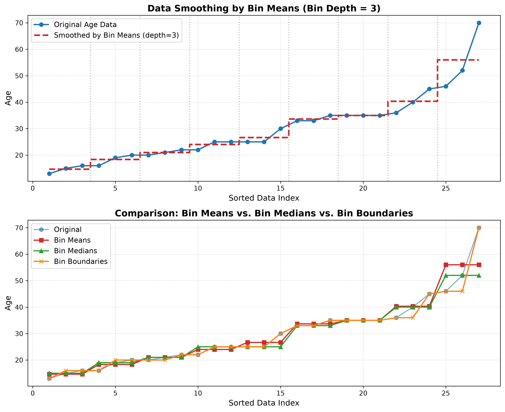
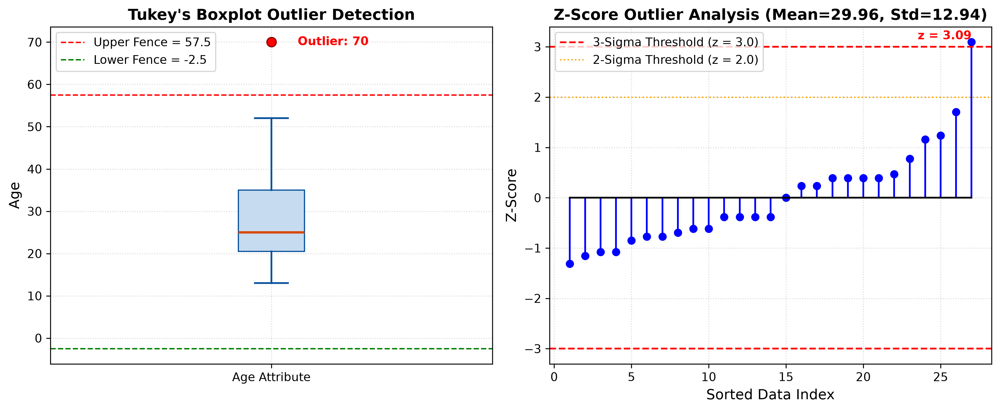
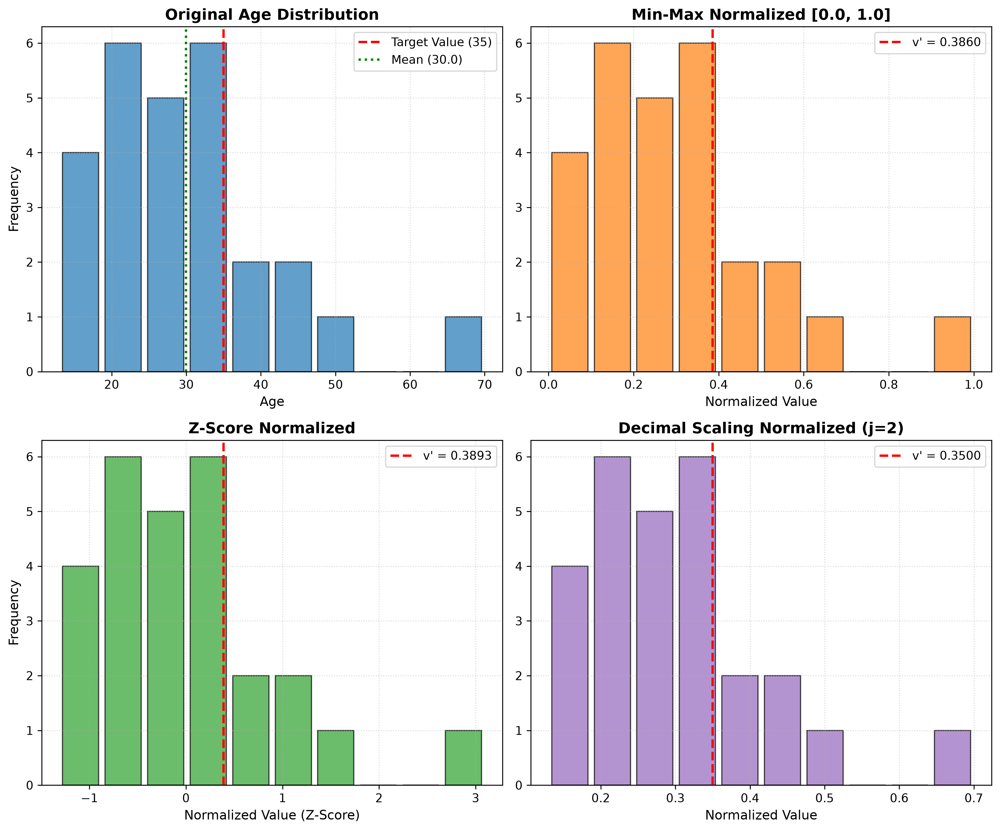
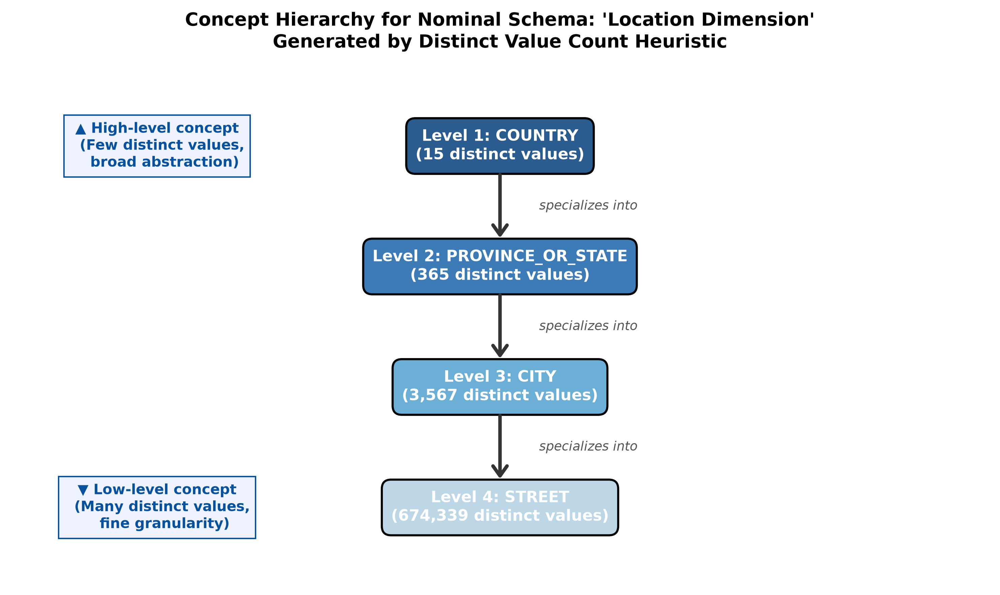

# Problem Set 2: Data Preparation

Comprehensive solutions, reproducible code implementations, mathematical derivations, and theoretical analyses for **Problem Set 2: Data Preparation** (Course: Data Mining - AIT3003).

Reference Textbook: *Data Mining: Concepts and Techniques (3rd Edition)* by Jiawei Han, Micheline Kamber, and Jian Pei (Morgan Kaufmann, 2011).

---

## Table of Contents
1. [Problem P1: Handling Missing Values](#problem-p1-handling-missing-values)
2. [Problem P2: Data Smoothing & Outlier Detection](#problem-p2-data-smoothing--outlier-detection)
   - [a. Smoothing by Bin Means (Depth = 3)](#a-smoothing-by-bin-means-depth--3)
   - [b. Outlier Determination](#b-outlier-determination)
   - [c. Alternative Data Smoothing Methods](#c-alternative-data-smoothing-methods)
3. [Problem P3: Issues in Data Integration](#problem-p3-issues-in-data-integration)
4. [Problem P4: Value Ranges of Normalization Methods](#problem-p4-value-ranges-of-normalization-methods)
5. [Problem P5: Normalization Calculations on Age Data](#problem-p5-normalization-calculations-on-age-data)
   - [a. Min-Max Normalization](#a-min-max-normalization)
   - [b. Z-Score Normalization](#b-z-score-normalization)
   - [c. Decimal Scaling Normalization](#c-decimal-scaling-normalization)
   - [d. Preferred Normalization Method & Justification](#d-preferred-normalization-method--justification)
6. [Problem P6: Automatic Concept Hierarchy Generation for Nominal Data](#problem-p6-automatic-concept-hierarchy-generation-for-nominal-data)
   - [Algorithmic Principle & Formulation](#algorithmic-principle--formulation)
   - [Pseudocode](#pseudocode)
   - [Concrete Schema Walkthrough & Visual Tree](#concrete-schema-walkthrough--visual-tree)
   - [Edge Cases & Domain Limitations](#edge-cases--domain-limitations)

---

## Problem P1: Handling Missing Values

> **Prompt:** In real-world data, tuples with missing values for some attributes are a common occurrence. Describe various methods for handling this problem.

In real-world data mining applications, incomplete data can arise from equipment malfunctions, human omission, schema mismatches during integration, or non-applicability of certain questions in surveys. 

The standard methods for resolving missing values (as established in Han, Kamber & Pei, Section 3.2.1) are:

### 1. Ignore the Tuple (Listwise Deletion / Complete Case Analysis)
* **Description:** Drop any record/tuple containing one or more missing attribute values.
* **When to use:** Highly effective and widely accepted when the **class label is missing** in supervised classification, or when the proportion of tuples with missing values is negligible (< 1–2%) and missingness is *Missing Completely at Random* (MCAR).
* **Limitations:** Causes severe information loss when missing values are spread across different attributes, drastically shrinking the effective sample size and introducing bias if missingness is non-random.

### 2. Fill in Missing Values Manually
* **Description:** Domain experts or data annotators review incomplete tuples and supply the correct values based on external knowledge.
* **When to use:** Critical high-stakes fields with small datasets (e.g., specialized medical diagnoses or clinical trials).
* **Limitations:** Extremely time-consuming, expensive, and completely infeasible for large-scale / big data applications.

### 3. Use a Global Constant
* **Description:** Replace all missing entries with a single uniform placeholder, such as `"Unknown"`, `"Missing"`, `-\infty`, or a sentinel numeric constant (e.g., `-999`).
* **When to use:** When you need a quick, lossless transformation and want to preserve the missingness indicator explicitly as a distinct category.
* **Limitations:** Mining algorithms (especially distance-based or numerical algorithms like k-means, regression, or neural networks) may interpret the constant as a genuine numeric value or cluster, causing substantial artifacts and false patterns.

### 4. Use Attribute Central Tendency Measures (Mean or Median)
* **Description:** Impute missing values using the central tendency computed from all observed values for that attribute:
  - **Mean ($\bar{x}$):** Recommended for approximately symmetric, unimodal (normal) distributions.
  - **Median:** Recommended for skewed distributions or datasets containing severe outliers, as the median is a resistant estimator.
* **When to use:** Unsupervised or exploratory workflows where rapid single imputation is required.
* **Limitations:** Artificially compresses the attribute variance, attenuates covariance with other attributes, and ignores relationships with correlated predictors.

### 5. Use Class-Conditional Central Tendency
* **Description:** Impute missing values using the mean or median calculated only over tuples belonging to the **same class / subgroup** (e.g., for missing `income`, impute using the mean income of individuals sharing the same `credit_risk = "Good"` label).
* **When to use:** Supervised learning tasks where attributes correlate strongly with the target class label.
* **Limitations:** Can introduce data leakage if applied across the whole dataset before train-test splitting. Only applicable when class labels are known and populated.

### 6. Predictive / Model-Based Imputation (Most Probable Value)
* **Description:** Treat the missing attribute as the target variable and build a predictive model using all other complete attributes as predictors:
  - **Regression Models:** Predict continuous values based on linear or generalized linear combinations.
  - **Decision Trees / Random Forests (e.g., missForest):** Capable of capturing non-linear relationships and interactions.
  - **$k$-Nearest Neighbors ($k$-NN):** Identify the $k$ most similar complete records based on distance metrics (e.g., Euclidean or Gower's distance) and assign their weighted average or mode.
  - **Bayesian Networks / Expectation-Maximization (EM):** Maximum likelihood estimation under probabilistic models.
* **When to use:** Preferred industry and academic standard when attributes exhibit strong interdependencies.
* **Limitations:** Computationally expensive; may overfit if missingness is high.

### 7. Multiple Imputation (e.g., MICE)
* **Description:** Generate $m > 1$ simulated values for each missing cell to create $m$ complete datasets. Analyze each dataset independently and pool the estimates using Rubin's rules.
* **When to use:** Rigorous inferential statistical modeling where quantifying imputation uncertainty is essential.

### Summary Comparison Table

| Method | Computational Complexity | Preserves Relationships | Robust to Outliers | Primary Drawback |
|:---|:---:|:---:|:---:|:---|
| **Ignore Tuple** | Minimal $O(1)$ | No | N/A | Substantial data loss |
| **Manual Imputation** | High (Human) | Yes | High | Not scalable |
| **Global Constant** | Minimal $O(1)$ | No | No | Distorts numerical algorithms |
| **Global Mean/Median** | Low $O(n)$ | Poor | Median: Yes, Mean: No | Underestimates variance |
| **Class Mean/Median** | Low $O(n)$ | Moderate | Median: Yes, Mean: No | Risk of target leakage |
| **Predictive ($k$-NN / Trees)** | Moderate to High | High | High | Computationally intensive |
| **Multiple Imputation** | High | Very High | High | High modeling overhead |

---

## Problem P2: Data Smoothing & Outlier Detection

> **Prompt:** Exercise 1 gave the following data (in increasing order) for the attribute age:
> $$13, 15, 16, 16, 19, 20, 20, 21, 22, 22, 25, 25, 25, 25, 30, 33, 33, 35, 35, 35, 35, 36, 40, 45, 46, 52, 70$$
> (a) Use smoothing by bin means to smooth these data, using a bin depth of 3. Illustrate your steps. Comment on the effect of this technique for the given data.  
> (b) How might you determine outliers in the data?  
> (c) What other methods are there for data smoothing?

### a. Smoothing by Bin Means (Depth = 3)

#### Step 1: Equal-Frequency Partitioning
The dataset has $n = 27$ observations. With a bin depth $d = 3$, the data is partitioned into $27 / 3 = 9$ equal-frequency bins:
- **Bin 1:** $[13, 15, 16]$
- **Bin 2:** $[16, 19, 20]$
- **Bin 3:** $[20, 21, 22]$
- **Bin 4:** $[22, 25, 25]$
- **Bin 5:** $[25, 25, 30]$
- **Bin 6:** $[33, 33, 35]$
- **Bin 7:** $[35, 35, 35]$
- **Bin 8:** $[36, 40, 45]$
- **Bin 9:** $[46, 52, 70]$

#### Step 2: Compute Bin Means
Calculate the arithmetic mean for each bin:
- **Mean(Bin 1):** $\frac{13 + 15 + 16}{3} = \frac{44}{3} \approx 14.67$
- **Mean(Bin 2):** $\frac{16 + 19 + 20}{3} = \frac{55}{3} \approx 18.33$
- **Mean(Bin 3):** $\frac{20 + 21 + 22}{3} = \frac{63}{3} = 21.00$
- **Mean(Bin 4):** $\frac{22 + 25 + 25}{3} = \frac{72}{3} = 24.00$
- **Mean(Bin 5):** $\frac{25 + 25 + 30}{3} = \frac{80}{3} \approx 26.67$
- **Mean(Bin 6):** $\frac{33 + 33 + 35}{3} = \frac{101}{3} \approx 33.67$
- **Mean(Bin 7):** $\frac{35 + 35 + 35}{3} = \frac{105}{3} = 35.00$
- **Mean(Bin 8):** $\frac{36 + 40 + 45}{3} = \frac{121}{3} \approx 40.33$
- **Mean(Bin 9):** $\frac{46 + 52 + 70}{3} = \frac{168}{3} = 56.00$

#### Step 3: Replace Values with Corresponding Bin Means
The smoothed dataset is:

| Bin | Original Values | Sum | Bin Mean (Exact) | Smoothed Values (2 d.p.) |
|:---:|:---:|:---:|:---:|:---:|
| **1** | $13, 15, 16$ | 44 | $44/3 \approx 14.6667$ | $14.67, 14.67, 14.67$ |
| **2** | $16, 19, 20$ | 55 | $55/3 \approx 18.3333$ | $18.33, 18.33, 18.33$ |
| **3** | $20, 21, 22$ | 63 | $63/3 = 21.0000$ | $21.00, 21.00, 21.00$ |
| **4** | $22, 25, 25$ | 72 | $72/3 = 24.0000$ | $24.00, 24.00, 24.00$ |
| **5** | $25, 25, 30$ | 80 | $80/3 \approx 26.6667$ | $26.67, 26.67, 26.67$ |
| **6** | $33, 33, 35$ | 101 | $101/3 \approx 33.6667$ | $33.67, 33.67, 33.67$ |
| **7** | $35, 35, 35$ | 105 | $105/3 = 35.0000$ | $35.00, 35.00, 35.00$ |
| **8** | $36, 40, 45$ | 121 | $121/3 \approx 40.3333$ | $40.33, 40.33, 40.33$ |
| **9** | $46, 52, 70$ | 168 | $168/3 = 56.0000$ | $56.00, 56.00, 56.00$ |

$$\text{Smoothed Data} = [14.67, 14.67, 14.67, 18.33, 18.33, 18.33, 21.00, 21.00, 21.00, 24.00, 24.00, 24.00, 26.67, 26.67, 26.67, 33.67, 33.67, 33.67, 35.00, 35.00, 35.00, 40.33, 40.33, 40.33, 56.00, 56.00, 56.00]$$



#### Comment on the Effect of this Technique:
1. **Noise Reduction & Trend Preservation:** The local arithmetic averaging smooths out minor fluctuations and irregularities, resulting in a cleaner monotonic step-function that mirrors the underlying global age progression.
2. **Mitigation of Extreme Values:** The isolated outlier ($70$) in Bin 9 is pulled down to $56.00$ by its neighboring points $46$ and $52$, reducing its distortive leverage on downstream models.
3. **Preservation of Low-Variance Intervals:** In Bin 7 ($[35, 35, 35]$), where there is zero variance, the bin mean remains exactly $35.00$.
4. **Information Loss / Quantization Trade-off:** Intra-bin variance is discarded; distinct adjacent values are collapsed into identical plateaus, sacrificing fine-grained precision for smoothness.

---

### b. Outlier Determination

Outliers in this dataset can be determined using both parametric and non-parametric statistical methods:

#### 1. Tukey's Interquartile Range (IQR) / Boxplot Rule (Non-Parametric)
From Problem Set 1:
- First Quartile ($Q_1$): $x_{(7)} = 20$
- Third Quartile ($Q_3$): $x_{(21)} = 35$
- Interquartile Range ($IQR$): $Q_3 - Q_1 = 35 - 20 = 15$
- Fences ($1.5 \times IQR = 1.5 \times 15 = 22.5$):
  $$\text{Lower Fence} = Q_1 - 1.5 \times IQR = 20 - 22.5 = -2.5$$
  $$\text{Upper Fence} = Q_3 + 1.5 \times IQR = 35 + 22.5 = 57.5$$
- Extreme Outer Fence ($3.0 \times IQR$):
  $$\text{Upper Extreme Fence} = Q_3 + 3.0 \times IQR = 35 + 45 = 80.0$$
- **Evaluation:** Since $70 > 57.5$ (and $70 \le 80.0$), the value **$70$ is statistically identified as a mild outlier**. All other points ($13 \le x_i \le 52$) fall within the inner fences.

#### 2. Standard Score ($Z$-Score) / $3\sigma$ Rule (Parametric)
- Sample Mean: $\bar{x} = \frac{809}{27} \approx 29.9630 \approx 29.96$
- Sample Standard Deviation: $s \approx 12.9421 \approx 12.94$
- Standardized score for $x = 70$:
  $$z = \frac{70 - 29.9630}{12.9421} = \frac{40.0370}{12.9421} \approx +3.0935$$
- For $x = 52$:
  $$z = \frac{52 - 29.9630}{12.9421} \approx +1.7027$$
- **Evaluation:** Under the standard $3\sigma$ threshold ($|z| > 3$), value **$70$ ($z = 3.09 > 3.0$) is confirmed as an outlier**.

#### 3. Modified $Z$-Score using Median and MAD (Robust)
Because sample mean and standard deviation are themselves affected by the outlier $70$, the Median Absolute Deviation (MAD) provides a robust alternative:
- $\text{Median} = 25$
- $\text{MAD} = \text{median}(|x_i - 25|) = 9.0$
- Modified $Z$-score for $x = 70$:
  $$M_i = \frac{0.6745 \times |70 - 25|}{\text{MAD}} = \frac{0.6745 \times 45}{9.0} = 3.3725$$
- (Values with $M_i > 3.5$ are typical extreme outliers; $M_i \approx 3.37$ confirms strong extremity).



---

### c. Alternative Data Smoothing Methods

Beyond smoothing by bin means, several methods exist for data smoothing:

1. **Smoothing by Bin Medians:**
   - In each bin, all values are replaced by the **median** of that bin.
   - *Example:* Bin 1 $[13, 15, 16] \to [15, 15, 15]$; Bin 9 $[46, 52, 70] \to [52, 52, 52]$.
   - *Advantage:* Highly robust against intra-bin extreme outliers (e.g., $70$ is replaced by $52$ rather than $56$).

2. **Smoothing by Bin Boundaries:**
   - The minimum and maximum values in a given bin serve as bin boundaries. Each value in the bin is replaced by the nearest boundary value.
   - *Example:* Bin 1 $[13, 15, 16] \to [13, 16, 16]$ (since $|15 - 13| = 2$ and $|16 - 15| = 1$, $15$ is closer to $16$).
   - *Advantage:* Preserves the dynamic range of each bin while eliminating intermediate noise.

3. **Regression:**
   - Fit the data points to a mathematical function:
     - **Linear Regression:** $y = w x + b$
     - **Polynomial / Multiple Regression:** Fits non-linear trends.
   - *Advantage:* Produces a continuous, parametric mathematical representation of the underlying relationship.

4. **Clustering:**
   - Unsupervised clustering algorithms (e.g., $k$-means, DBSCAN) group similar data points together.
   - Values within each cluster are replaced by the cluster centroid; points that do not fall into any cluster are detected and eliminated as noise.

5. **Moving Average / Exponential Smoothing:**
   - Frequently applied to time-series or sequential data:
     - **Simple Moving Average (SMA):** Smooths by averaging over a sliding window of width $w$.
     - **Exponentially Weighted Moving Average (EWMA):** Weights recent observations more heavily than older ones.

6. **Wavelet and Spectral Transforms:**
   - Transforms signals into frequency/wavelet components, filters out high-frequency coefficients (which correspond to noise), and reconstructs the smoothed signal via inverse transform.

---

## Problem P3: Issues in Data Integration

> **Prompt:** Discuss issues to consider during data integration.

Data integration combines data from multiple heterogeneous sources (e.g., databases, flat files, APIs, OLTP systems) into a unified, coherent data store. As detailed in Han, Kamber & Pei (Section 3.3), four primary issues must be addressed:

### 1. Schema Integration and Entity Identification Problem
* **Entity Identification:** How can equivalent real-world entities from different sources be reliably identified and matched? For example, does `cust_id` in Database A represent the exact same entity as `customer_number` in Database B?
* **Attribute Naming Discrepancies:**
  - **Synonyms:** Different names representing the same attribute (e.g., `client_code` vs. `account_id`, or `annual_income` vs. `salary`).
  - **Homonyms / Polysemy:** The same name referring to different attributes (e.g., `address` meaning billing address in one system and physical delivery location in another).
* **Structural Differences:** One database may represent an entity as an atomic attribute, while another models it as a child table with multiple normalized columns.
* **Resolution:** Thorough metadata analysis using data dictionaries, ontology mapping, and automated schema matching frameworks.

### 2. Redundancy and Correlation Analysis
* **Attribute Redundancy:** An attribute is redundant if it can be derived or computed from other attributes (e.g., storing both `birth_date` and `age`, or `unit_price`, `quantity`, and `total_amount`).
* **Consequences of Redundancy:** Causes storage bloat, inconsistent multi-copy updates, and severe multicollinearity that impairs statistical modeling.
* **Correlation Detection:**
  - **Nominal Attributes:** Evaluated using the **$\chi^2$ (Chi-Square) Test of Independence**:
    $$\chi^2 = \sum_{i=1}^c \sum_{j=1}^r \frac{(o_{ij} - e_{ij})^2}{e_{ij}}$$
  - **Numerical Attributes:** Evaluated using the **Pearson Correlation Coefficient ($r$)** or **Covariance**:
    $$r_{A, B} = \frac{\sum (a_i - \bar{A})(b_i - \bar{B})}{(n-1) s_A s_B}$$

### 3. Tuple Duplication (Record Linkage / Deduplication)
* **Description:** Identical or near-identical real-world records may exist multiple times due to repeated data entries, merging overlapping databases, or typographical errors.
* **Resolution:** Record linkage, fuzzy string matching (Levenshtein distance, Jaro-Winkler metric), deterministic rules, and clustering-based entity resolution algorithms.

### 4. Data Value Conflicts and Semantic Inconsistency
* **Representation Differences:** Discrepant units of measurement (e.g., metric kilograms vs. imperial pounds, Celsius vs. Fahrenheit).
* **Currency Differences:** Transactions recorded in USD, EUR, or VND without proper exchange rate conversion.
* **Encoding & Scale Conflicts:** One system represents gender as `'M'`/`'F'`, another as `1`/`2`, and another as `'Male'`/`'Female'`. Scale differences like grading on a 4.0 scale vs. 10.0 or 100.0.
* **Temporal Divergence:** Data sources may capture snapshots at different timestamps or have different update frequencies (e.g., daily batch vs. real-time stream), creating conflicting values for what should be the same entity state.
* **Resolution:** Establishing explicit Master Data Management (MDM) governance, data standardization rules, and automated transformation pipelines.

---

## Problem P4: Value Ranges of Normalization Methods

> **Prompt:** What are the value ranges of the following normalization methods?  
> (a) min-max normalization  
> (b) z-score normalization  
> (c) z-score normalization using the mean absolute deviation instead of standard deviation  
> (d) normalization by decimal scaling

### (a) Min-Max Normalization
* **Mathematical Formula:**
  $$v' = \frac{v - \min_A}{\max_A - \min_A} (\text{new\_max}_A - \text{new\_min}_A) + \text{new\_min}_A$$
* **Value Range:**
  $$\mathbf{[\text{new\_min}_A, \, \text{new\_max}_A]}$$
* When standardly mapped onto $[0.0, 1.0]$, the range is strictly the closed interval $\mathbf{[0.0, 1.0]}$.
* *Note on Out-of-Sample Data:* If unseen test instances fall below $\min_A$ or above $\max_A$, an "out-of-bounds error" occurs and $v'$ can fall outside this interval unless clipping is enforced.

### (b) Z-Score Normalization (Zero-Mean Normalization)
* **Mathematical Formula:**
  $$v' = \frac{v - \bar{A}}{\sigma_A}$$
* **Value Range:**
  $$\mathbf{(-\infty, \, +\infty)}$$
* The range is mathematically unbounded (the entire real number line $\mathbb{R}$). While empirical normal distributions have $\approx 99.73\%$ of data within $[-3, +3]$, extreme values and heavy tails can produce values arbitrarily far from zero.

### (c) Z-Score Normalization using Mean Absolute Deviation
* **Mathematical Formula:**
  $$v' = \frac{v - \bar{A}}{s_A} \quad \text{where } s_A = \frac{1}{n} \sum_{i=1}^n |v_i - \bar{A}|$$
* **Value Range:**
  $$\mathbf{(-\infty, \, +\infty)}$$
* The value range remains mathematically unbounded ($\mathbb{R}$). Using $s_A$ (or median absolute deviation $\text{MAD}$) reduces the squared leverage of outliers, but does not impose upper or lower boundaries.

### (d) Normalization by Decimal Scaling
* **Mathematical Formula:**
  $$v' = \frac{v}{10^j}$$
  where $j$ is the smallest integer such that $\max(|v'|) < 1$ (i.e., $\frac{\max(|v|)}{10^j} < 1$).
* **Value Range:**
  $$\mathbf{(-1.0, \, 1.0)}$$
* Because $j$ is explicitly defined such that $\max(|v'|) < 1$, the normalized value is strictly bounded within the open interval $(-1.0, 1.0)$.
* *Non-negative subset:* If all values of attribute $A$ are non-negative ($v \ge 0$), the range is the half-open interval $\mathbf{[0.0, \, 1.0)}$.

---

## Problem P5: Normalization Calculations on Age Data

> **Prompt:** Using the data for age given in Exercise 1:
> $$13, 15, 16, 16, 19, 20, 20, 21, 22, 22, 25, 25, 25, 25, 30, 33, 33, 35, 35, 35, 35, 36, 40, 45, 46, 52, 70$$
> answer the following:  
> (a) Use min-max normalization to transform the value 35 for age onto the range [0.0, 1.0].  
> (b) Use z-score normalization to transform the value 35 for age, where the standard deviation of age is 12.94 years.  
> (c) Use normalization by decimal scaling to transform the value 35 for age.  
> (d) Comment on which method you would prefer to use for the given data, giving reasons as to why.

**Summary Statistics of Age:**
- $n = 27$
- $\min = 13$, $\max = 70$
- Sum: $\sum x_i = 809 \implies \bar{x}_{\text{exact}} = \frac{809}{27} \approx 29.9630$ (rounded: $29.96$)
- Given Standard Deviation: $s = 12.94$ years
- Target Value: $v = 35$

---

### a. Min-Max Normalization
Transform $v = 35$ onto $[\text{new\_min}, \text{new\_max}] = [0.0, 1.0]$:
$$v' = \frac{v - \min}{\max - \min} = \frac{35 - 13}{70 - 13} = \frac{22}{57}$$

$$\mathbf{v' \approx 0.385965 \approx 0.3860}$$

---

### b. Z-Score Normalization
Transform $v = 35$ with standard deviation $s = 12.94$:
- **Using Rounded Mean ($\bar{x} = 29.96$):**
  $$v' = \frac{35 - 29.96}{12.94} = \frac{5.04}{12.94} \approx \mathbf{0.389490 \approx 0.3895}$$

- **Using Exact Mean ($\bar{x} = \frac{809}{27} \approx 29.962963$):**
  $$v' = \frac{35 - 29.962963}{12.94} = \frac{5.037037}{12.94} \approx \mathbf{0.389261 \approx 0.3893}$$

---

### c. Decimal Scaling Normalization
- Maximum absolute value: $\max(|v|) = 70$.
- Determine $j$: smallest integer such that $\frac{70}{10^j} < 1$:
  - For $j = 1$: $\frac{70}{10^1} = 7.0 \not< 1$
  - For $j = 2$: $\frac{70}{10^2} = 0.70 < 1 \implies \mathbf{j = 2}$ (divisor $= 10^2 = 100$).
- Transform $v = 35$:
  $$v' = \frac{35}{10^2} = \frac{35}{100} = \mathbf{0.3500}$$

---

### d. Preferred Normalization Method & Justification

**Preferred Method:** **Z-Score Normalization** (specifically robust Z-score using MAD or standard deviation).

#### Detailed Justification:
1. **Severe Outlier Sensitivity in Min-Max Normalization:**
   - The age distribution contains an extreme outlier: age **$70$** (Tukey's upper fence is $57.5$).
   - In Min-Max scaling, this isolated point inflates the range $(\max - \min = 57)$. As a direct result, **$26$ out of $27$ observations ($96.3\%$ of the dataset) are compressed into a narrow band $[0.0, 0.684]$**, leaving the upper third of the interval largely vacant. This artificial distortion squashes feature variance.
2. **Deficiencies of Decimal Scaling:**
   - Decimal scaling shifts the decimal point purely based on an arbitrary power of 10 ($10^2 = 100$). It does not center the distribution around zero, nor does it standardize variance.
3. **Out-of-Bounds Robustness in Future Data:**
   - Min-Max normalization fails if future individuals are younger than 13 or older than 70 without clipping.
   - Z-score normalization handles unbounded future values smoothly.
4. **Preservation of Statistical Properties:**
   - Z-score normalization centers the distribution around $\mu = 0$ and scales to unit variance $\sigma = 1$, making it the optimal choice for subsequent machine learning algorithms that rely on distance or gradient descent (e.g., $k$-NN, SVMs, PCA, neural networks).



---

## Problem P6: Automatic Concept Hierarchy Generation for Nominal Data

> **Prompt:** Propose an algorithm, in pseudo code or in your favorite programming language, for the following: The automatic generation of a concept hierarchy for nominal data based on the number of distinct values of attributes in the given schema.

### Algorithmic Principle & Formulation

In multidimensional data warehouses and OLAP schemas, concept hierarchies for nominal attributes (e.g., location, product, time) organize dimensions into levels of abstraction to enable **drill-down** and **roll-up** operations.

As described in Han, Kamber & Pei (Section 3.5.6):
> *"Higher-level concepts generally cover several subordinate lower-level concepts. Therefore, an attribute defining a high concept level (e.g., `country`) will usually contain a smaller number of distinct values than an attribute defining a lower concept level (e.g., `street`)."*

#### Heuristic Rule:
1. Count the number of distinct values for each nominal attribute in the schema dimension:
   $$C_i = |\text{distinct}(A_i)|$$
2. Sort the attributes in **ascending order** of their distinct value counts:
   $$C_{(1)} \le C_{(2)} \le \dots \le C_{(m)}$$
3. Construct the hierarchy chain from top to bottom:
   - **Level 1 (Top / Root):** Attribute $A_{(1)}$ with the fewest distinct values (most generalized concept).
   - **Level $m$ (Bottom / Leaf):** Attribute $A_{(m)}$ with the most distinct values (most detailed concept).

---

### Pseudocode

```text
Algorithm: GenerateConceptHierarchyByDistinctCount
Input:
    S: Schema dimension containing a set of nominal attributes {A_1, A_2, ..., A_m}
    D: Dataset instance conforming to schema S
Output:
    H: Concept hierarchy tree / ordered level list (Top-to-Bottom)

Begin:
    1. Initialize an empty dictionary distinct_counts = {}
    
    2. For each attribute A_i in S:
           distinct_values = Set of unique non-null values of A_i in D
           distinct_counts[A_i] = |distinct_values|
    
    3. Sort the attributes in ascending order of their distinct counts:
           sorted_attributes = Sort(distinct_counts.keys, key = distinct_counts[A])
           (i.e., distinct_counts[A_(1)] <= distinct_counts[A_(2)] <= ... <= distinct_counts[A_(m)])
    
    4. Construct the Hierarchy Levels:
           Initialize Root Node of H with Level 1: sorted_attributes[0]
           For k from 1 to m - 1:
               Add sorted_attributes[k] as child / subordinate level of sorted_attributes[k - 1]
    
    5. Return H (Level 1: Top Concept -> Level m: Bottom Concept)
End
```

---

### Concrete Schema Walkthrough & Visual Tree

#### Example 1: Location Dimension (Textbook Example 3.7)
Consider a location dimension with attributes: `street`, `city`, `province_or_state`, `country`.
- `country`: $15$ distinct values $\implies$ **Level 1 (Top / Root)**
- `province_or_state`: $365$ distinct values $\implies$ **Level 2**
- `city`: $3,567$ distinct values $\implies$ **Level 3**
- `street`: $674,339$ distinct values $\implies$ **Level 4 (Bottom / Leaf)**

**Hierarchical Partial Order (Specific < General):**
$$\text{street} < \text{city} < \text{province\_or\_state} < \text{country}$$

#### Example 2: Product Taxonomy Dimension
- `product_line`: $8$ distinct values $\implies$ **Level 1**
- `category`: $42$ distinct values $\implies$ **Level 2**
- `brand`: $250$ distinct values $\implies$ **Level 3**
- `item_sku`: $18,500$ distinct values $\implies$ **Level 4**



---

### Python Implementation

```python
from typing import Dict, List, Tuple

class ConceptHierarchyGenerator:
    """
    Automatic concept hierarchy generator for nominal schema attributes
    based on the number of distinct values per attribute (Han & Kamber, Sec 3.5.6).
    """
    def __init__(self, dimension_name: str):
        self.dimension_name = dimension_name
        self.attributes: Dict[str, int] = {}
        
    def add_attribute(self, attr_name: str, distinct_count: int):
        if distinct_count < 1:
            raise ValueError(f"Distinct count must be >= 1 for {attr_name}")
        self.attributes[attr_name] = distinct_count
        
    def generate_hierarchy(self) -> List[Tuple[str, int]]:
        # Ascending sort: fewest distinct values -> highest abstraction level
        return sorted(self.attributes.items(), key=lambda item: item[1])

# Usage demonstration:
generator = ConceptHierarchyGenerator("Location")
generator.add_attribute("country", 15)
generator.add_attribute("province_or_state", 365)
generator.add_attribute("city", 3567)
generator.add_attribute("street", 674339)

hierarchy = generator.generate_hierarchy()
for level, (attr, count) in enumerate(hierarchy, 1):
    print(f"Level {level}: {attr:<20} ({count:,d} distinct values)")
```

---

### Edge Cases & Domain Limitations

While this heuristic is highly effective in hierarchical geographical and organizational schemas, it must be augmented with domain validation to avoid the following edge cases:

1. **Semantic Inversion (e.g., Time Dimension):**
   - In a database spanning 20 years, we might observe:
     - `day_of_week`: 7 distinct values
     - `month`: 12 distinct values
     - `year`: 20 distinct values
   - Strict distinct value sorting would produce: $\text{day\_of\_week} \to \text{month} \to \text{year}$, placing `day_of_week` at the root of the hierarchy! This violates temporal semantics (days do not generalize years).
2. **Functional Dependency Verification:**
   - A valid hierarchy strictly requires a many-to-one mapping ($A_{k} \to A_{k-1}$). For instance, each `street` must belong to a single `city`, and each `city` to a single `country`. The algorithm should verify database functional dependencies rather than relying solely on counts.
3. **User-in-the-Loop Override:**
   - The system should present the automatically derived schema hierarchy to human domain experts for confirmation or manual reordering where semantic exceptions arise.

---

## Reproducibility & Code Execution

To re-run all calculations and regenerate figures:

```bash
# Execute the comprehensive Python solution
python solution.py
```

Generated artifact plots are stored under [`images/`](images/):
- [`p2_bin_smoothing.png`](images/p2_bin_smoothing.png)
- [`p2_outlier_detection.png`](images/p2_outlier_detection.png)
- [`p5_normalization_comparison.png`](images/p5_normalization_comparison.png)
- [`p6_concept_hierarchy.png`](images/p6_concept_hierarchy.png)
