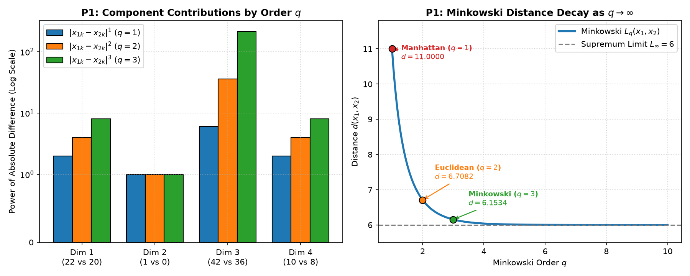
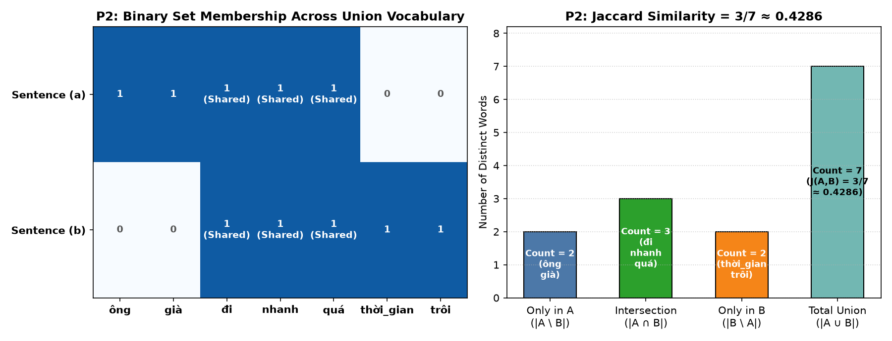
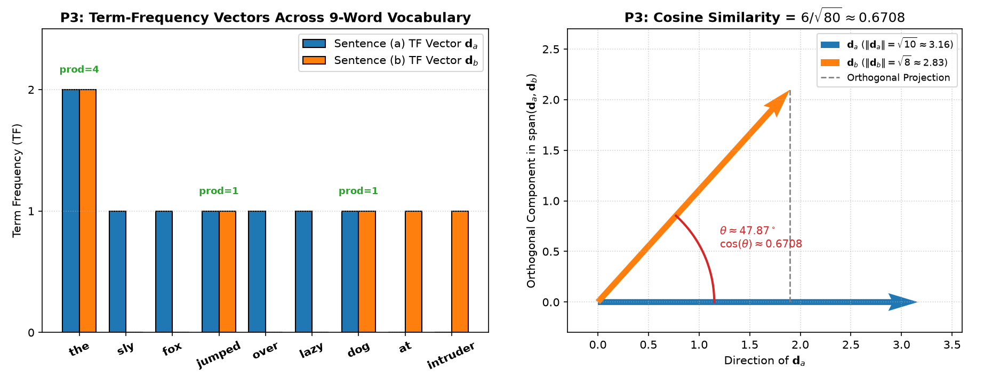
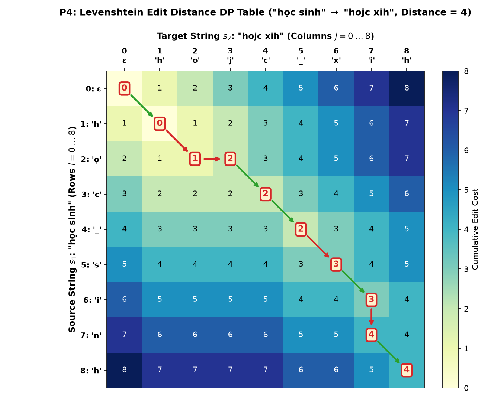

# Problem Set 3: Similarity and Distance Measures (Các độ đo tương tự và khoảng cách)

Comprehensive solutions, step-by-step mathematical derivations, dynamic programming tables, and reproducible visualizations for **Problem Set 3: Similarity Measures** (Course: Data Mining - AIT3003).

Reference Textbook: *Data Mining: Concepts and Techniques (3rd Edition)* by Jiawei Han, Micheline Kamber, and Jian Pei (Morgan Kaufmann, 2011, Section 2.4).

---

## Table of Contents
1. [Problem P1: Euclidean, Manhattan, and Minkowski Distances](#problem-p1-euclidean-manhattan-and-minkowski-distances)
   - [a. Euclidean Distance](#a-euclidean-distance-q--2)
   - [b. Manhattan Distance](#b-manhattan-distance-q--1)
   - [c. Minkowski Distance ($q = 3$)](#c-minkowski-distance-q--3)
   - [Summary & Geometric Interpretation](#summary--geometric-interpretation)
2. [Problem P2: Jaccard Similarity Between Word Sets](#problem-p2-jaccard-similarity-between-word-sets)
   - [Primary Calculation (Whitespace Tokenization)](#1-primary-calculation-whitespace-tokenization-as-given)
   - [Alternative Compound-Word Note](#2-alternative-note-vietnamese-compound-word-segmentation-for-ông-già)
3. [Problem P3: Term-Frequency Vectors and Cosine Similarity](#problem-p3-term-frequency-vectors-and-cosine-similarity)
   - [Vocabulary & Term-Frequency Matrix (Case-Insensitive)](#1-primary-calculation-standard-case-insensitive-vocabulary)
   - [Cosine Similarity Derivation](#2-cosine-similarity-derivation)
   - [Alternative Case-Sensitive Note](#3-alternative-note-case-sensitive-tokens-the-vs-the)
4. [Problem P4: Levenshtein Edit Distance Dynamic Programming Table](#problem-p4-levenshtein-edit-distance-dynamic-programming-table)
   - [Formulation & Recurrence Relation](#1-formulation--recurrence-relation)
   - [Complete $(9 \times 9)$ Dynamic Programming Table](#2-complete-9-times-9-dynamic-programming-table)
   - [Step-by-Step Optimal Edit Alignment](#3-step-by-step-optimal-edit-alignment)
   - [Additional Variants (No-Space & Substitution Cost = 2)](#4-additional-variants-verification)

---

## Problem P1: Euclidean, Manhattan, and Minkowski Distances

> **Prompt:** Cho hai đối tượng được biểu diễn bằng các bộ số $(22, 1, 42, 10)$ và $(20, 0, 36, 8)$:  
> (a) Tính khoảng cách Euclidean giữa hai đối tượng này.  
> (b) Tính khoảng cách Manhattan giữa hai đối tượng này.  
> (c) Tính khoảng cách Minkowski giữa hai đối tượng này, sử dụng $q = 3$.

Let the two $p$-dimensional data objects ($p = 4$) be:
$$\mathbf{x}_1 = (22, 1, 42, 10), \quad \mathbf{x}_2 = (20, 0, 36, 8)$$

First, compute the component-wise absolute differences $\Delta_k = |x_{1k} - x_{2k}|$ for $k \in \{1, 2, 3, 4\}$:
- $\Delta_1 = |22 - 20| = 2$
- $\Delta_2 = |1 - 0| = 1$
- $\Delta_3 = |42 - 36| = 6$
- $\Delta_4 = |10 - 8| = 2$

$$\boldsymbol{\Delta} = (2, 1, 6, 2)$$

---

### a. Euclidean Distance ($q = 2$)
The Euclidean ($L_2$) distance is defined as:
$$d_{\text{Euclidean}}(\mathbf{x}_1, \mathbf{x}_2) = \sqrt{\sum_{k=1}^{4} |x_{1k} - x_{2k}|^2}$$

Substituting the component differences:
$$d_{\text{Euclidean}}(\mathbf{x}_1, \mathbf{x}_2) = \sqrt{2^2 + 1^2 + 6^2 + 2^2} = \sqrt{4 + 1 + 36 + 4} = \sqrt{45} = 3\sqrt{5} \approx \mathbf{6.7082}$$

---

### b. Manhattan Distance ($q = 1$)
The Manhattan (City-Block / $L_1$) distance is defined as:
$$d_{\text{Manhattan}}(\mathbf{x}_1, \mathbf{x}_2) = \sum_{k=1}^{4} |x_{1k} - x_{2k}|$$

Substituting the component differences:
$$d_{\text{Manhattan}}(\mathbf{x}_1, \mathbf{x}_2) = 2 + 1 + 6 + 2 = \mathbf{11}$$

---

### c. Minkowski Distance ($q = 3$)
The Minkowski ($L_q$) distance of order $q \ge 1$ is defined as:
$$d_{\text{Minkowski}}(\mathbf{x}_1, \mathbf{x}_2) = \left( \sum_{k=1}^{4} |x_{1k} - x_{2k}|^q \right)^{\frac{1}{q}}$$

For $q = 3$:
$$d_{\text{Minkowski}, \, q=3}(\mathbf{x}_1, \mathbf{x}_2) = \left( 2^3 + 1^3 + 6^3 + 2^3 \right)^{\frac{1}{3}} = \left( 8 + 1 + 216 + 8 \right)^{\frac{1}{3}} = \sqrt[3]{233} \approx \mathbf{6.1534}$$

*(Supplementary Reference: As $q \to \infty$, the Minkowski distance converges to the **Supremum / Chebyshev ($L_\infty$) distance**: $d_\infty(\mathbf{x}_1, \mathbf{x}_2) = \max_{k} |x_{1k} - x_{2k}| = \max(2, 1, 6, 2) = \mathbf{6}$.)*

---

### Summary & Geometric Interpretation

| Distance Metric | Order ($q$) | Formula | Exact Form | Numerical Value |
|:---|:---:|:---|:---:|:---:|
| **Manhattan ($L_1$)** | $q = 1$ | $\sum_{k=1}^4 \Delta_k$ | $11$ | **$11.0000$** |
| **Euclidean ($L_2$)** | $q = 2$ | $\left(\sum_{k=1}^4 \Delta_k^2\right)^{1/2}$ | $\sqrt{45} = 3\sqrt{5}$ | **$6.7082$** |
| **Minkowski ($L_3$)** | $q = 3$ | $\left(\sum_{k=1}^4 \Delta_k^3\right)^{1/3}$ | $\sqrt[3]{233}$ | **$6.1534$** |
| **Supremum ($L_\infty$)** | $q \to \infty$ | $\max_{k} \Delta_k$ | $6$ | **$6.0000$** |

Notice the inequality $d_{L_1} \ge d_{L_2} \ge d_{L_3} \ge d_{L_\infty}$ ($11 > 6.7082 > 6.1534 > 6$): as $q$ increases, the largest coordinate difference ($\Delta_3 = 6$) increasingly dominates the norm.



---

## Problem P2: Jaccard Similarity Between Word Sets

> **Prompt:** Cho hai câu sau, hãy tính độ tương tự Jaccard giữa chúng bằng cách coi mỗi câu là một tập từ.  
> (a) “ông già đi nhanh quá”  
> (b) “thời_gian trôi đi nhanh quá”.

Given two sets $A$ and $B$, the **Jaccard similarity coefficient** (and corresponding **Jaccard distance**) are defined as:
$$\text{sim}_{\text{Jaccard}}(A, B) = J(A, B) = \frac{|A \cap B|}{|A \cup B|} = \frac{|A \cap B|}{|A| + |B| - |A \cap B|}, \qquad d_{\text{Jaccard}}(A, B) = 1 - J(A, B)$$

---

### 1. Primary Calculation (Whitespace Tokenization as Given)
In the prompt, `"thời_gian"` is explicitly pre-joined with an underscore `_` as a single token, while `"ông già"` is written as two space-separated tokens:

- **Set $A$ (from sentence a):**
  $$A = \{\text{``ông''}, \, \text{``già''}, \, \text{``đi''}, \, \text{``nhanh''}, \, \text{``quá''}\}, \quad |A| = 5$$
- **Set $B$ (from sentence b):**
  $$B = \{\text{``thời\_gian''}, \, \text{``trôi''}, \, \text{``đi''}, \, \text{``nhanh''}, \, \text{``quá''}\}, \quad |B| = 5$$

1. **Intersection ($A \cap B$):**
   $$A \cap B = \{\text{``đi''}, \, \text{``nhanh''}, \, \text{``quá''}\} \implies |A \cap B| = 3$$

2. **Union ($A \cup B$):**
   $$A \cup B = \{\text{``ông''}, \, \text{``già''}, \, \text{``thời\_gian''}, \, \text{``trôi''}, \, \text{``đi''}, \, \text{``nhanh''}, \, \text{``quá''}\} \implies |A \cup B| = 5 + 5 - 3 = 7$$

3. **Jaccard Similarity:**
   $$J(A, B) = \frac{|A \cap B|}{|A \cup B|} = \frac{3}{7} \approx \mathbf{0.4286} \quad (42.86\%)$$
   *(Corresponding Jaccard Distance: $d_J(A, B) = 1 - \frac{3}{7} = \frac{4}{7} \approx 0.5714$.)*

---

### 2. Alternative Note (Vietnamese Compound-Word Segmentation for `"ông già"`)
If a Vietnamese word segmenter also groups `"ông già"` into a single compound token `"ông_già"` (matching `"thời_gian"`):
- $A' = \{\text{``ông\_già''}, \, \text{``đi''}, \, \text{``nhanh''}, \, \text{``quá''}\}$ ($|A'| = 4$)
- $B = \{\text{``thời\_gian''}, \, \text{``trôi''}, \, \text{``đi''}, \, \text{``nhanh''}, \, \text{``quá''}\}$ ($|B| = 5$)
- $|A' \cap B| = 3$, $|A' \cup B| = 4 + 5 - 3 = 6$
- $J(A', B) = \frac{3}{6} = \frac{1}{2} = \mathbf{0.5000}$



---

## Problem P3: Term-Frequency Vectors and Cosine Similarity

> **Prompt:** Biểu diễn các câu sau thành vector tần suất từ và tính độ tương tự cosine giữa chúng:  
> (a) “The sly fox jumped over the lazy dog.”  
> (b) “The dog jumped at the intruder.”  
> *Lưu ý: Cần xác định tập từ vựng của cả hai câu. Vector biểu diễn mỗi câu sẽ có số chiều là kích thước tập từ vựng đó (mỗi chiều ứng với một từ, giá trị là tần suất từ trong câu – có thể bằng 0).*

---

### 1. Primary Calculation (Standard Case-Insensitive Vocabulary)
After stripping trailing periods (`.`) and normalizing case to lowercase so that `"The"` and `"the"` map to the same lexical word `"the"`:
- **Tokens in (a) (8 words):** `["the", "sly", "fox", "jumped", "over", "the", "lazy", "dog"]`
- **Tokens in (b) (6 words):** `["the", "dog", "jumped", "at", "the", "intruder"]`

#### Vocabulary $V$ ($|V| = 9$ dimensions):
Ordered by first appearance across the two sentences:
$$V = [\text{``the''}, \, \text{``sly''}, \, \text{``fox''}, \, \text{``jumped''}, \, \text{``over''}, \, \text{``lazy''}, \, \text{``dog''}, \, \text{``at''}, \, \text{``intruder''}]$$

#### Term-Frequency (TF) Table:

| Dimension $k$ | Word $w_k \in V$ | TF in Sentence (a) ($d_{a,k}$) | TF in Sentence (b) ($d_{b,k}$) | Product ($d_{a,k} \cdot d_{b,k}$) | $d_{a,k}^2$ | $d_{b,k}^2$ |
|:---:|:---|:---:|:---:|:---:|:---:|:---:|
| 1 | **`the`** | **2** | **2** | $2 \times 2 = \mathbf{4}$ | $4$ | $4$ |
| 2 | `sly` | 1 | 0 | $1 \times 0 = 0$ | $1$ | $0$ |
| 3 | `fox` | 1 | 0 | $1 \times 0 = 0$ | $1$ | $0$ |
| 4 | **`jumped`** | **1** | **1** | $1 \times 1 = \mathbf{1}$ | $1$ | $1$ |
| 5 | `over` | 1 | 0 | $1 \times 0 = 0$ | $1$ | $0$ |
| 6 | `lazy` | 1 | 0 | $1 \times 0 = 0$ | $1$ | $0$ |
| 7 | **`dog`** | **1** | **1** | $1 \times 1 = \mathbf{1}$ | $1$ | $1$ |
| 8 | `at` | 0 | 1 | $0 \times 1 = 0$ | $0$ | $1$ |
| 9 | `intruder` | 0 | 1 | $0 \times 1 = 0$ | $0$ | $1$ |
| **Total** | **9 words** | $\sum = 8$ | $\sum = 6$ | $\mathbf{d}_a \cdot \mathbf{d}_b = \mathbf{6}$ | $\|\mathbf{d}_a\|^2 = \mathbf{10}$ | $\|\mathbf{d}_b\|^2 = \mathbf{8}$ |

Thus, the 9-dimensional term-frequency vectors are:
$$\mathbf{d}_a = (2, 1, 1, 1, 1, 1, 1, 0, 0)$$
$$\mathbf{d}_b = (2, 0, 0, 1, 0, 0, 1, 1, 1)$$

---

### 2. Cosine Similarity Derivation
The cosine similarity between two vectors $\mathbf{d}_a$ and $\mathbf{d}_b$ is:
$$\cos(\mathbf{d}_a, \mathbf{d}_b) = \frac{\mathbf{d}_a \cdot \mathbf{d}_b}{\|\mathbf{d}_a\| \, \|\mathbf{d}_b\|}$$

1. **Dot Product ($\mathbf{d}_a \cdot \mathbf{d}_b$):**
   $$\mathbf{d}_a \cdot \mathbf{d}_b = (2)(2) + (1)(0) + (1)(0) + (1)(1) + (1)(0) + (1)(0) + (1)(1) + (0)(1) + (0)(1) = 4 + 1 + 1 = \mathbf{6}$$

2. **Euclidean Norms ($\|\mathbf{d}_a\|$ and $\|\mathbf{d}_b\|$):**
   $$\|\mathbf{d}_a\| = \sqrt{2^2 + 1^2 + 1^2 + 1^2 + 1^2 + 1^2 + 1^2 + 0^2 + 0^2} = \sqrt{4 + 6} = \sqrt{10} \approx 3.1623$$
   $$\|\mathbf{d}_b\| = \sqrt{2^2 + 0^2 + 0^2 + 1^2 + 0^2 + 0^2 + 1^2 + 1^2 + 1^2} = \sqrt{4 + 4} = \sqrt{8} = 2\sqrt{2} \approx 2.8284$$

3. **Cosine Similarity:**
   $$\cos(\mathbf{d}_a, \mathbf{d}_b) = \frac{6}{\sqrt{10} \times \sqrt{8}} = \frac{6}{\sqrt{80}} = \frac{6}{4\sqrt{5}} = \frac{3}{2\sqrt{5}} = \frac{3\sqrt{5}}{10} \approx \mathbf{0.6708}$$
   - **Angle between vectors:** $\theta = \arccos(0.67082) \approx \mathbf{47.87^\circ}$.

---

### 3. Alternative Note (Case-Sensitive Tokens: `"The"` vs `"the"`)
If case is preserved so `"The"` and `"the"` are treated as two distinct words ($|V_{\text{cs}}| = 10$):
- $V_{\text{cs}} = [\text{``The''}, \, \text{``sly''}, \, \text{``fox''}, \, \text{``jumped''}, \, \text{``over''}, \, \text{``the''}, \, \text{``lazy''}, \, \text{``dog''}, \, \text{``at''}, \, \text{``intruder''}]$
- $\mathbf{d}_a^{\text{cs}} = (1, 1, 1, 1, 1, 1, 1, 1, 0, 0) \implies \|\mathbf{d}_a^{\text{cs}}\| = \sqrt{8}$
- $\mathbf{d}_b^{\text{cs}} = (1, 0, 0, 1, 0, 1, 0, 1, 1, 1) \implies \|\mathbf{d}_b^{\text{cs}}\| = \sqrt{6}$
- $\mathbf{d}_a^{\text{cs}} \cdot \mathbf{d}_b^{\text{cs}} = 1 + 1 + 1 + 1 = 4$
- $\cos(\mathbf{d}_a^{\text{cs}}, \mathbf{d}_b^{\text{cs}}) = \frac{4}{\sqrt{8}\sqrt{6}} = \frac{4}{\sqrt{48}} = \frac{1}{\sqrt{3}} \approx \mathbf{0.5774}$



---

## Problem P4: Levenshtein Edit Distance Dynamic Programming Table

> **Prompt:** Lập bảng tính khoảng cách soạn thảo Levenshtein sử dụng ba phép toán: xóa, chèn và thay thế một ký tự trong chuỗi cho hai chuỗi sau “học sinh” và “hojc xih” (Lưu ý: ‘ọ’ cũng tính là một ký tự).

---

### 1. Formulation & Recurrence Relation
Let:
- **Source string $s_1$:** `"học sinh"` of length $m = 8$:
  $$s_1[1..8] = [\text{'h'}, \, \text{'ọ'}, \, \text{'c'}, \, \text{' '}, \, \text{'s'}, \, \text{'i'}, \, \text{'n'}, \, \text{'h'}]$$
- **Target string $s_2$:** `"hojc xih"` of length $n = 8$:
  $$s_2[1..8] = [\text{'h'}, \, \text{'o'}, \, \text{'j'}, \, \text{'c'}, \, \text{' '}, \, \text{'x'}, \, \text{'i'}, \, \text{'h'}]$$
*(Here `'_'` denotes the space character `' '`, and `'ọ'` is counted as a single character as specified.)*

Under the standard Levenshtein edit distance (unit cost $= 1$ for each of the three edit operations: **deletion**, **insertion**, and **substitution**), let $D[i, j]$ denote the minimum edit distance between prefix $s_1[1..i]$ and prefix $s_2[1..j]$:

1. **Base cases:**
   $$D[i, 0] = i \quad (0 \le i \le m), \qquad D[0, j] = j \quad (0 \le j \le n)$$
2. **Recurrence relation ($1 \le i \le m, \, 1 \le j \le n$):**
   $$D[i, j] = \min \begin{cases}
   D[i - 1, j] + 1 & \text{(Deletion of } s_1[i]\text{)} \\
   D[i, j - 1] + 1 & \text{(Insertion of } s_2[j]\text{)} \\
   D[i - 1, j - 1] + c_{\text{sub}}(s_1[i], s_2[j]) & \text{(Match if } c_{\text{sub}}=0\text{; Substitution if } c_{\text{sub}}=1\text{)}
   \end{cases}$$
   where $c_{\text{sub}}(a, b) = 0$ if $a = b$, and $1$ if $a \ne b$.

---

### 2. Complete $(9 \times 9)$ Dynamic Programming Table
*(Bold entries indicate the optimal backtrace alignment path from $(0,0)$ to $(8,8)$.)*

| $s_1 \setminus s_2$ | $j=0$<br>$\varepsilon$ | $j=1$<br>`'h'` | $j=2$<br>`'o'` | $j=3$<br>`'j'` | $j=4$<br>`'c'` | $j=5$<br>`'_'` | $j=6$<br>`'x'` | $j=7$<br>`'i'` | $j=8$<br>`'h'` |
|:---:|:---:|:---:|:---:|:---:|:---:|:---:|:---:|:---:|:---:|
| **$i=0$: $\varepsilon$** | **0** | 1 | 2 | 3 | 4 | 5 | 6 | 7 | 8 |
| **$i=1$: `'h'`** | 1 | **0** | 1 | 2 | 3 | 4 | 5 | 6 | 7 |
| **$i=2$: `'ọ'`** | 2 | 1 | **1** | **2** | 3 | 4 | 5 | 6 | 7 |
| **$i=3$: `'c'`** | 3 | 2 | 2 | 2 | **2** | 3 | 4 | 5 | 6 |
| **$i=4$: `'_'`** | 4 | 3 | 3 | 3 | 3 | **2** | 3 | 4 | 5 |
| **$i=5$: `'s'`** | 5 | 4 | 4 | 4 | 4 | 3 | **3** | 4 | 5 |
| **$i=6$: `'i'`** | 6 | 5 | 5 | 5 | 5 | 4 | 4 | **3** | 4 |
| **$i=7$: `'n'`** | 7 | 6 | 6 | 6 | 6 | 5 | 5 | **4** | 4 |
| **$i=8$: `'h'`** | 8 | 7 | 7 | 7 | 7 | 6 | 6 | 5 | **4** |

$$\implies \text{Minimum Levenshtein Edit Distance } d_L(\text{``học sinh''}, \, \text{``hojc xih''}) = D[8, 8] = \mathbf{4}$$



---

### 3. Step-by-Step Optimal Edit Alignment

Transforming `"học sinh"` $\longrightarrow$ `"hojc xih"` requires **4 operations** (2 substitutions, 1 insertion, 1 deletion):

| Step | DP Transition | Characters Aligned | Edit Operation | Operation Cost | Cumulative Cost | Intermediate String |
|:---:|:---:|:---:|:---|:---:|:---:|:---|
| 0 | $(0, 0)$ | $\varepsilon \to \varepsilon$ | Initial state | $0$ | $0$ | `"học sinh"` |
| 1 | $(0, 0) \to (1, 1)$ | `'h'` $\to$ `'h'` | **Match** `'h'` | $0$ | $0$ | `"học sinh"` |
| 2 | $(1, 1) \to (2, 2)$ | `'ọ'` $\to$ `'o'` | **Substitute** `'ọ'` $\to$ `'o'` | $+1$ | $1$ | `"hoc sinh"` |
| 3 | $(2, 2) \to (2, 3)$ | $\varepsilon \to$ `'j'` | **Insert** `'j'` | $+1$ | $2$ | `"hojc sinh"` |
| 4 | $(2, 3) \to (3, 4)$ | `'c'` $\to$ `'c'` | **Match** `'c'` | $0$ | $2$ | `"hojc sinh"` |
| 5 | $(3, 4) \to (4, 5)$ | `' '` $\to$ `' '` | **Match** `' '` (space) | $0$ | $2$ | `"hojc sinh"` |
| 6 | $(4, 5) \to (5, 6)$ | `'s'` $\to$ `'x'` | **Substitute** `'s'` $\to$ `'x'` | $+1$ | $3$ | `"hojc xinh"` |
| 7 | $(5, 6) \to (6, 7)$ | `'i'` $\to$ `'i'` | **Match** `'i'` | $0$ | $3$ | `"hojc xinh"` |
| 8 | $(6, 7) \to (7, 7)$ | `'n'` $\to \varepsilon$ | **Delete** `'n'` | $+1$ | $4$ | `"hojc xih"` |
| 9 | $(7, 7) \to (8, 8)$ | `'h'` $\to$ `'h'` | **Match** `'h'` | $0$ | **$4$** | **`"hojc xih"`** |

Character-level alignment summary:
```text
Source (s1):   h   ọ   -   c   _   s   i   n   h
Operation  :   =  sub ins  =   =  sub  =  del  =
Target (s2):   h   o   j   c   _   x   i   -   h
Cost       :   0 + 1 + 1 + 0 + 0 + 1 + 0 + 1 + 0  =  4
```

---

### 4. Additional Variants Verification
1. **If whitespace `' '` is omitted (`"họcsinh"` vs `"hojcxih"`, $7 \times 7$ table):**
   Since the space `' '` in both strings aligns with cost $0$, omitting whitespace yields the exact same edit distance: **$d_L = 4$**.
2. **If Substitution has cost $= 2$ (Jurafsky & Martin NLP convention, where $\text{Sub} = \text{Del} + \text{Ins}$):**
   Each of the 2 substitutions (`'ọ'` $\to$ `'o'` and `'s'` $\to$ `'x'`) incurs cost $2$ instead of $1$, yielding $D[8, 8] = 2(2) + 1 + 1 = \mathbf{6}$.
