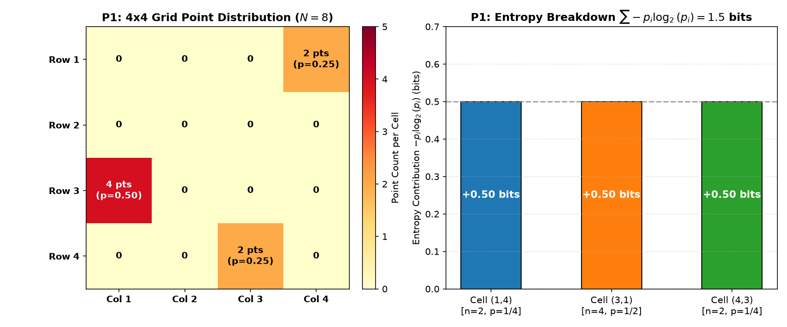
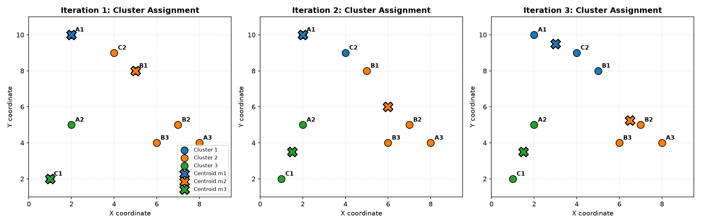
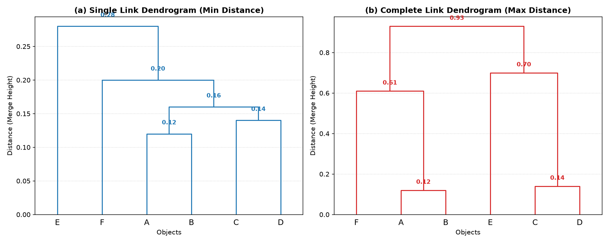

# Problem Set 4: Clustering (Phân cụm dữ liệu)

Comprehensive solutions, reproducible code implementations, mathematical derivations, step-by-step iterations, and dendrograms for **Problem Set 4: Clustering** (Course: Data Mining - AIT3003).

Reference Textbook: *Data Mining: Concepts and Techniques (3rd Edition)* by Jiawei Han, Micheline Kamber, and Jian Pei (Morgan Kaufmann, 2011, Chapter 10: Cluster Analysis: Basic Concepts and Methods).

---

## Table of Contents
1. [Problem P1: Cell-Based Entropy for Grid-Based Data](#problem-p1-cell-based-entropy-for-grid-based-data)
   - [Grid Analysis & Point Distribution](#1-grid-analysis--point-distribution)
   - [Shannon Entropy Mathematical Derivation](#2-shannon-entropy-mathematical-derivation)
   - [Normalized Entropy and Data Mining Significance](#3-normalized-entropy-and-significance)
2. [Problem P2: K-Means Clustering on 2D Spatial Points](#problem-p2-k-means-clustering-on-2d-spatial-points)
   - [Problem Setup & Initial Centroids](#1-problem-setup--initial-centroids)
   - [Iteration 1: Distance Computations, Assignments & New Centroids](#2-iteration-1-distance-computations-assignments--new-centroids)
   - [Iteration 2: Re-assignment & Centroid Updates](#3-iteration-2-re-assignment--centroid-updates)
   - [Iteration 3 & Convergence (Iteration 4)](#4-iteration-3--convergence-iteration-4)
   - [Summary of Answers (Part a & b)](#5-summary-of-answers-part-a--b)
3. [Problem P3: Agglomerative Hierarchical Clustering](#problem-p3-agglomerative-hierarchical-clustering)
   - [Given Pairwise Distance Matrix](#1-given-pairwise-distance-matrix)
   - [Part (a): Single Link (Minimum Distance) Dendrogram](#2-part-a-single-link-minimum-distance-clustering)
   - [Part (b): Complete Link (Maximum Distance) Dendrogram](#3-part-b-complete-link-maximum-distance-clustering)
   - [Comparison between Single Link and Complete Link](#4-comparison-between-single-link-and-complete-link)

---

## Problem P1: Cell-Based Entropy for Grid-Based Data

> **Prompt:** Cho một tập dữ liệu gồm 8 điểm dữ liệu phân bố trong lưới $4 \times 4$ như hình vẽ. Hãy tính entropy $H$ của phân bố các điểm dữ liệu đó theo phương pháp cell-based entropy.

### 1. Grid Analysis & Point Distribution

The domain is discretized into an equal-sized $4 \times 4$ grid, containing $m = 4 \times 4 = 16$ spatial cells (bins).  
Total number of points: $N = 8$.

Counting the points located in each cell $(r, c)$ where $r \in \{1, 2, 3, 4\}$ (rows top to bottom) and $c \in \{1, 2, 3, 4\}$ (columns left to right):

| Row $\setminus$ Column | Column 1 | Column 2 | Column 3 | Column 4 | Row Total |
|:---|:---:|:---:|:---:|:---:|:---:|
| **Row 1** | $0$ | $0$ | $0$ | **$2$** | $2$ |
| **Row 2** | $0$ | $0$ | $0$ | $0$ | $0$ |
| **Row 3** | **$4$** | $0$ | $0$ | $0$ | $4$ |
| **Row 4** | $0$ | $0$ | **$2$** | $0$ | $2$ |
| **Column Total** | $4$ | $0$ | $2$ | $2$ | **$N = 8$** |

- There are **3 non-empty cells**:
  1. $c_1 = \text{Cell}(1, 4)$ contains $n_1 = 2$ points.
  2. $c_2 = \text{Cell}(3, 1)$ contains $n_2 = 4$ points.
  3. $c_3 = \text{Cell}(4, 3)$ contains $n_3 = 2$ points.
- The remaining $13$ cells contain $0$ points.

---

### 2. Shannon Entropy Mathematical Derivation

In grid-based subspace clustering (such as the **ENCLUS** algorithm - *Entropy-based CLUStEring* by Cheng et al., 1999; and Han & Kamber, Chapter 10), the probability (or density ratio) of cell $c_i$ is given by:
$$p_i = \frac{n_i}{N}$$

For empty cells ($n_i = 0$), $p_i = 0$. By standard mathematical convention in information theory:
$$\lim_{p \to 0^+} p \log_2 p = 0$$

For the 3 non-empty cells:
- $p_1 = \frac{2}{8} = \frac{1}{4} = 0.25$
- $p_2 = \frac{4}{8} = \frac{1}{2} = 0.50$
- $p_3 = \frac{2}{8} = \frac{1}{4} = 0.25$

Check: $\sum_{i=1}^{16} p_i = \frac{1}{4} + \frac{1}{2} + \frac{1}{4} = 1.0$.

#### Cell-Based Entropy $H$ (Base 2):
$$H = -\sum_{i=1}^{m} p_i \log_2(p_i) = -\left[ p_1 \log_2(p_1) + p_2 \log_2(p_2) + p_3 \log_2(p_3) \right]$$

Substitute the probabilities:
- $p_1 \log_2(p_1) = \frac{1}{4} \log_2\left(\frac{1}{4}\right) = \frac{1}{4} (-2) = -0.50$
- $p_2 \log_2(p_2) = \frac{1}{2} \log_2\left(\frac{1}{2}\right) = \frac{1}{2} (-1) = -0.50$
- $p_3 \log_2(p_3) = \frac{1}{4} \log_2\left(\frac{1}{4}\right) = \frac{1}{4} (-2) = -0.50$

$$H = -\left[ -0.50 - 0.50 - 0.50 \right] = -(-1.50) = \mathbf{1.5000 \text{ bits}}$$

*(If using the natural logarithm $\ln$ base $e$: $H_e = -\sum p_i \ln p_i = 2 \times (0.25 \ln 4) + 0.5 \ln 2 = 1.5 \times \ln 2 \approx \mathbf{1.0397 \text{ nats}}$.)*

---

### 3. Normalized Entropy and Significance

The maximum possible entropy for $m = 16$ cells occurs when points are uniformly spread across all 16 cells ($p_i = 1/16$ for all $i$):
$$H_{\max} = \log_2(16) = 4.0 \text{ bits}$$

The **normalized cell-based entropy** is:
$$H_{\text{norm}} = \frac{H}{H_{\max}} = \frac{1.50}{4.00} = \mathbf{0.3750} \quad (37.5\%)$$

A low entropy ($1.5 \ll 4.0$) indicates strong clustering tendency in the subspace: the points are highly concentrated in very few dense grid cells rather than scattered uniformly across the space.

---

## Problem P2: K-Means Clustering on 2D Spatial Points

> **Prompt:** Giả sử rằng nhiệm vụ khai thác dữ liệu là nhóm điểm (với $(x, y)$ biểu diễn vị trí) thành ba cụm, trong đó các điểm là:  
> $A_1(2,10), A_2(2,5), A_3(8,4), B_1(5,8), B_2(7,5), B_3(6,4), C_1(1,2), C_2(4,9)$.  
> Hàm khoảng cách là khoảng cách Euclidean. Giả sử ban đầu chúng ta gán $A_1, B_1$ và $C_1$ làm tâm của mỗi cụm, tương ứng. Sử dụng thuật toán k-means để chỉ ra:  
> a) Ba tâm cụm sau vòng thực thi đầu tiên.  
> b) Ba cụm cuối cùng.

### 1. Problem Setup & Initial Centroids

- $k = 3$ clusters ($C_1, C_2, C_3$).
- $8$ points:
  - $A_1 = (2, 10)$
  - $A_2 = (2, 5)$
  - $A_3 = (8, 4)$
  - $B_1 = (5, 8)$
  - $B_2 = (7, 5)$
  - $B_3 = (6, 4)$
  - $C_1 = (1, 2)$
  - $C_2 = (4, 9)$
- Distance function: Euclidean distance $d(\mathbf{p}, \mathbf{m}) = \sqrt{(p_x - m_x)^2 + (p_y - m_y)^2}$.
- Initial seeds:
  - $\mathbf{m}_1^{(0)} = A_1 = (2, 10)$
  - $\mathbf{m}_2^{(0)} = B_1 = (5, 8)$
  - $\mathbf{m}_3^{(0)} = C_1 = (1, 2)$

---

### 2. Iteration 1: Distance Computations, Assignments & New Centroids

Compute Euclidean distance from every point $\mathbf{p}$ to $\mathbf{m}_1(2, 10)$, $\mathbf{m}_2(5, 8)$, and $\mathbf{m}_3(1, 2)$:

| Point | $(x, y)$ | $d(\mathbf{p}, \mathbf{m}_1)$ | $d(\mathbf{p}, \mathbf{m}_2)$ | $d(\mathbf{p}, \mathbf{m}_3)$ | Minimum Distance | Assigned Cluster |
|:---|:---:|:---:|:---:|:---:|:---:|:---:|
| **$A_1$** | $(2, 10)$ | $\sqrt{0^2 + 0^2} = \mathbf{0.0000}$ | $\sqrt{3^2 + 2^2} \approx 3.6056$ | $\sqrt{1^2 + 8^2} \approx 8.0623$ | $0.0000$ | **Cluster 1** |
| **$A_2$** | $(2, 5)$ | $\sqrt{0^2 + 5^2} = 5.0000$ | $\sqrt{3^2 + 3^2} \approx 4.2426$ | $\sqrt{1^2 + 3^2} \approx \mathbf{3.1623}$ | $3.1623$ | **Cluster 3** |
| **$A_3$** | $(8, 4)$ | $\sqrt{6^2 + 6^2} \approx 8.4853$ | $\sqrt{3^2 + 4^2} = \mathbf{5.0000}$ | $\sqrt{7^2 + 2^2} \approx 7.2801$ | $5.0000$ | **Cluster 2** |
| **$B_1$** | $(5, 8)$ | $\sqrt{3^2 + 2^2} \approx 3.6056$ | $\sqrt{0^2 + 0^2} = \mathbf{0.0000}$ | $\sqrt{4^2 + 6^2} \approx 7.2111$ | $0.0000$ | **Cluster 2** |
| **$B_2$** | $(7, 5)$ | $\sqrt{5^2 + 5^2} \approx 7.0711$ | $\sqrt{2^2 + 3^2} \approx \mathbf{3.6056}$ | $\sqrt{6^2 + 3^2} \approx 6.7082$ | $3.6056$ | **Cluster 2** |
| **$B_3$** | $(6, 4)$ | $\sqrt{4^2 + 6^2} \approx 7.2111$ | $\sqrt{1^2 + 4^2} \approx \mathbf{4.1231}$ | $\sqrt{5^2 + 2^2} \approx 5.3852$ | $4.1231$ | **Cluster 2** |
| **$C_1$** | $(1, 2)$ | $\sqrt{1^2 + 8^2} \approx 8.0623$ | $\sqrt{4^2 + 6^2} \approx 7.2111$ | $\sqrt{0^2 + 0^2} = \mathbf{0.0000}$ | $0.0000$ | **Cluster 3** |
| **$C_2$** | $(4, 9)$ | $\sqrt{2^2 + 1^2} \approx 2.2361$ | $\sqrt{1^2 + 1^2} \approx \mathbf{1.4142}$ | $\sqrt{3^2 + 7^2} \approx 7.6158$ | $1.4142$ | **Cluster 2** |

#### Cluster Assignments after Iteration 1:
- $\text{Cluster } 1 = \{A_1\}$
- $\text{Cluster } 2 = \{A_3, B_1, B_2, B_3, C_2\}$
- $\text{Cluster } 3 = \{A_2, C_1\}$

#### Update Centroids $\mathbf{m}^{(1)}$:
- $\mathbf{m}_1^{(1)} = \frac{(2, 10)}{1} = \mathbf{(2, 10)}$
- $\mathbf{m}_2^{(1)} = \frac{(8,4) + (5,8) + (7,5) + (6,4) + (4,9)}{5} = \frac{(30, 30)}{5} = \mathbf{(6, 6)}$
- $\mathbf{m}_3^{(1)} = \frac{(2,5) + (1,2)}{2} = \frac{(3, 7)}{2} = \mathbf{(1.5, 3.5)}$

---

### 3. Iteration 2: Re-assignment & Centroid Updates

With updated centroids $\mathbf{m}_1^{(1)} = (2, 10)$, $\mathbf{m}_2^{(1)} = (6, 6)$, $\mathbf{m}_3^{(1)} = (1.5, 3.5)$:

| Point | $(x, y)$ | $d(\mathbf{p}, \mathbf{m}_1)$ | $d(\mathbf{p}, \mathbf{m}_2)$ | $d(\mathbf{p}, \mathbf{m}_3)$ | Minimum | New Cluster | Shift Note |
|:---|:---:|:---:|:---:|:---:|:---:|:---:|:---|
| **$A_1$** | $(2, 10)$ | $\mathbf{0.0000}$ | $5.6569$ | $6.5192$ | $0.0000$ | Cluster 1 | Stays |
| **$A_2$** | $(2, 5)$ | $5.0000$ | $4.1231$ | $\mathbf{1.5811}$ | $1.5811$ | Cluster 3 | Stays |
| **$A_3$** | $(8, 4)$ | $8.4853$ | $\mathbf{2.8284}$ | $6.5192$ | $2.8284$ | Cluster 2 | Stays |
| **$B_1$** | $(5, 8)$ | $3.6056$ | $\mathbf{2.2361}$ | $5.7009$ | $2.2361$ | Cluster 2 | Stays |
| **$B_2$** | $(7, 5)$ | $7.0711$ | $\mathbf{1.4142}$ | $5.7009$ | $1.4142$ | Cluster 2 | Stays |
| **$B_3$** | $(6, 4)$ | $7.2111$ | $\mathbf{2.0000}$ | $4.5277$ | $2.0000$ | Cluster 2 | Stays |
| **$C_1$** | $(1, 2)$ | $8.0623$ | $6.4031$ | $\mathbf{1.5811}$ | $1.5811$ | Cluster 3 | Stays |
| **$C_2$** | $(4, 9)$ | $\mathbf{2.2361}$ | $3.6056$ | $6.0415$ | $2.2361$ | **Cluster 1** | **Moves from C2 to C1!** |

#### Cluster Assignments after Iteration 2:
- $\text{Cluster } 1 = \{A_1, C_2\}$
- $\text{Cluster } 2 = \{A_3, B_1, B_2, B_3\}$
- $\text{Cluster } 3 = \{A_2, C_1\}$

#### Update Centroids $\mathbf{m}^{(2)}$:
- $\mathbf{m}_1^{(2)} = \frac{(2,10) + (4,9)}{2} = \mathbf{(3.0, 9.5)}$
- $\mathbf{m}_2^{(2)} = \frac{(8,4) + (5,8) + (7,5) + (6,4)}{4} = \frac{(26, 21)}{4} = \mathbf{(6.5, 5.25)}$
- $\mathbf{m}_3^{(2)} = \mathbf{(1.5, 3.5)}$ (unchanged)

---

### 4. Iteration 3 & Convergence (Iteration 4)

With centroids $\mathbf{m}_1^{(2)} = (3, 9.5)$, $\mathbf{m}_2^{(2)} = (6.5, 5.25)$, $\mathbf{m}_3^{(2)} = (1.5, 3.5)$:

- Evaluating $B_1(5, 8)$:
  - $d(B_1, \mathbf{m}_1) = \sqrt{(5-3)^2 + (8-9.5)^2} = \sqrt{4 + 2.25} = \sqrt{6.25} = \mathbf{2.5000}$
  - $d(B_1, \mathbf{m}_2) = \sqrt{(5-6.5)^2 + (8-5.25)^2} = \sqrt{2.25 + 7.5625} = \sqrt{9.8125} \approx 3.1325$
  - Since $2.5000 < 3.1325$, **$B_1$ moves from Cluster 2 to Cluster 1!**

#### Cluster Assignments after Iteration 3:
- $\text{Cluster } 1 = \{A_1, B_1, C_2\}$
- $\text{Cluster } 2 = \{A_3, B_2, B_3\}$
- $\text{Cluster } 3 = \{A_2, C_1\}$

#### Update Centroids $\mathbf{m}^{(3)}$:
- $\mathbf{m}_1^{(3)} = \frac{(2,10) + (5,8) + (4,9)}{3} = \frac{(11, 27)}{3} = \left(\frac{11}{3}, 9\right) \approx \mathbf{(3.6667, 9.0000)}$
- $\mathbf{m}_2^{(3)} = \frac{(8,4) + (7,5) + (6,4)}{3} = \frac{(21, 13)}{3} = \left(7, \frac{13}{3}\right) \approx \mathbf{(7.0000, 4.3333)}$
- $\mathbf{m}_3^{(3)} = \frac{(2,5) + (1,2)}{2} = \mathbf{(1.5000, 3.5000)}$

#### Iteration 4 (Verification of Convergence):
Recomputing all distances to $\mathbf{m}_1^{(3)}, \mathbf{m}_2^{(3)}, \mathbf{m}_3^{(3)}$:
- Every point is closest to its currently assigned cluster centroid:
  - $A_1 \to C_1 (d=1.94)$
  - $A_2 \to C_3 (d=1.58)$
  - $A_3 \to C_2 (d=1.05)$
  - $B_1 \to C_1 (d=1.67)$
  - $B_2 \to C_2 (d=0.67)$
  - $B_3 \to C_2 (d=1.05)$
  - $C_1 \to C_3 (d=1.58)$
  - $C_2 \to C_1 (d=0.33)$
- **No point shifts clusters! The algorithm terminates with full convergence.**

---

### 5. Summary of Answers (Part a & b)

#### (a) Ba tâm cụm sau vòng thực thi đầu tiên:
$$\mathbf{m}_1^{(1)} = \mathbf{(2, 10)}$$
$$\mathbf{m}_2^{(1)} = \mathbf{(6, 6)}$$
$$\mathbf{m}_3^{(1)} = \mathbf{(1.5, 3.5)}$$

#### (b) Ba cụm cuối cùng:
- **Cụm 1:** $\{A_1, B_1, C_2\} = \{(2, 10), (5, 8), (4, 9)\}$, tâm cụm $\mathbf{m}_1^* = \left(\frac{11}{3}, 9\right) \approx (3.67, 9.00)$
- **Cụm 2:** $\{A_3, B_2, B_3\} = \{(8, 4), (7, 5), (6, 4)\}$, tâm cụm $\mathbf{m}_2^* = \left(7, \frac{13}{3}\right) \approx (7.00, 4.33)$
- **Cụm 3:** $\{A_2, C_1\} = \{(2, 5), (1, 2)\}$, tâm cụm $\mathbf{m}_3^* = (1.5, 3.5)$

---

## Problem P3: Agglomerative Hierarchical Clustering

> **Prompt:** Bảng dưới đây là ma trận khoảng cách của 6 đối tượng:  
> a) Chỉ ra kết quả cuối cùng của phân cụm phân cấp với liên kết đơn (single link) bằng cách vẽ sơ đồ phân cấp (dendrogram).  
> b) Chỉ ra kết quả cuối cùng của phân cụm phân cấp với liên kết hoàn chỉnh (complete link) bằng cách vẽ sơ đồ phân cấp.

### 1. Given Pairwise Distance Matrix

$$D = \begin{bmatrix}
 & A & B & C & D & E & F \\
A & 0 & & & & & \\
B & 0.12 & 0 & & & & \\
C & 0.51 & 0.25 & 0 & & & \\
D & 0.84 & 0.16 & 0.14 & 0 & & \\
E & 0.28 & 0.77 & 0.70 & 0.45 & 0 & \\
F & 0.34 & 0.61 & 0.93 & 0.20 & 0.67 & 0
\end{bmatrix}$$

---

### 2. Part (a): Single Link (Minimum Distance) Clustering

In **Single Link (Nearest Neighbor)** clustering, the distance between two clusters $C_i$ and $C_j$ is the minimum distance between any pair of their constituent points:
$$d_{\text{single}}(C_i, C_j) = \min_{\mathbf{x} \in C_i, \, \mathbf{y} \in C_j} d(\mathbf{x}, \mathbf{y})$$

#### Step 1:
- The global minimum entry is $d(A, B) = \mathbf{0.12}$.
- **Merge $\{A\}$ and $\{B\}$** into cluster $(A, B)$ at height $h = 0.12$.
- Update distances:
  - $d((A, B), C) = \min(0.51, 0.25) = 0.25$
  - $d((A, B), D) = \min(0.84, 0.16) = 0.16$
  - $d((A, B), E) = \min(0.28, 0.77) = 0.28$
  - $d((A, B), F) = \min(0.34, 0.61) = 0.34$

#### Step 2:
- Among remaining pairs, the minimum distance is $d(C, D) = \mathbf{0.14}$.
- **Merge $\{C\}$ and $\{D\}$** into cluster $(C, D)$ at height $h = 0.14$.
- Update distances:
  - $d((C, D), (A, B)) = \min(d(C, (A, B)), d(D, (A, B))) = \min(0.25, 0.16) = 0.16$
  - $d((C, D), E) = \min(0.70, 0.45) = 0.45$
  - $d((C, D), F) = \min(0.93, 0.20) = 0.20$

#### Step 3:
- The minimum distance is $d((A, B), (C, D)) = \mathbf{0.16}$ (via edge $B - D$).
- **Merge $(A, B)$ and $(C, D)$** into cluster $(A, B, C, D)$ at height $h = 0.16$.
- Update distances:
  - $d((A, B, C, D), E) = \min(0.28, 0.45) = 0.28$
  - $d((A, B, C, D), F) = \min(0.34, 0.20) = 0.20$
  - $d(E, F) = 0.67$

#### Step 4:
- The minimum distance is $d((A, B, C, D), F) = \mathbf{0.20}$ (via edge $D - F$).
- **Merge $(A, B, C, D)$ and $\{F\}$** into cluster $(A, B, C, D, F)$ at height $h = 0.20$.
- Update distance:
  - $d((A, B, C, D, F), E) = \min(0.28, 0.67) = 0.28$ (via edge $A - E$)

#### Step 5:
- The only remaining pair is $(A, B, C, D, F)$ and $\{E\}$ with distance $\mathbf{0.28}$.
- **Merge into root cluster $(A, B, C, D, E, F)$** at height $h = 0.28$.

#### Single Link Merge Sequence Summary:

| Step | Clusters Merged | Linkage Distance | New Cluster Formed |
|:---:|:---:|:---:|:---|
| 1 | $A$ and $B$ | $\mathbf{0.12}$ | $\{A, B\}$ |
| 2 | $C$ and $D$ | $\mathbf{0.14}$ | $\{C, D\}$ |
| 3 | $\{A, B\}$ and $\{C, D\}$ | $\mathbf{0.16}$ | $\{A, B, C, D\}$ |
| 4 | $\{A, B, C, D\}$ and $F$ | $\mathbf{0.20}$ | $\{A, B, C, D, F\}$ |
| 5 | $\{A, B, C, D, F\}$ and $E$ | $\mathbf{0.28}$ | $\{A, B, C, D, E, F\}$ |

---

### 3. Part (b): Complete Link (Maximum Distance) Clustering

In **Complete Link (Furthest Neighbor)** clustering, the distance between two clusters is the maximum distance between any pair of their constituent points:
$$d_{\text{complete}}(C_i, C_j) = \max_{\mathbf{x} \in C_i, \, \mathbf{y} \in C_j} d(\mathbf{x}, \mathbf{y})$$

#### Step 1:
- Minimum initial entry is $d(A, B) = \mathbf{0.12}$.
- **Merge $\{A\}$ and $\{B\}$** into cluster $(A, B)$ at height $h = 0.12$.
- Update complete distances:
  - $d((A, B), C) = \max(0.51, 0.25) = 0.51$
  - $d((A, B), D) = \max(0.84, 0.16) = 0.84$
  - $d((A, B), E) = \max(0.28, 0.77) = 0.77$
  - $d((A, B), F) = \max(0.34, 0.61) = 0.61$

#### Step 2:
- Among remaining pairs, the minimum distance is $d(C, D) = \mathbf{0.14}$.
- **Merge $\{C\}$ and $\{D\}$** into cluster $(C, D)$ at height $h = 0.14$.
- Update complete distances:
  - $d((C, D), (A, B)) = \max(d(C, (A,B)), d(D, (A,B))) = \max(0.51, 0.84) = 0.84$
  - $d((C, D), E) = \max(0.70, 0.45) = 0.70$
  - $d((C, D), F) = \max(0.93, 0.20) = 0.93$

#### Step 3:
Current pairwise distances between clusters $(A, B)$, $(C, D)$, $E$, and $F$:
- $d((A, B), F) = \mathbf{0.61}$
- $d(E, F) = 0.67$
- $d((C, D), E) = 0.70$
- $d((A, B), E) = 0.77$
- $d((A, B), (C, D)) = 0.84$
- $d((C, D), F) = 0.93$

Minimum distance is $d((A, B), F) = \mathbf{0.61}$.
- **Merge $(A, B)$ and $\{F\}$** into cluster $(A, B, F)$ at height $h = 0.61$.
- Update distances:
  - $d((A, B, F), E) = \max(d((A, B), E), d(F, E)) = \max(0.77, 0.67) = 0.77$
  - $d((A, B, F), (C, D)) = \max(d((A, B), (C, D)), d(F, (C, D))) = \max(0.84, 0.93) = 0.93$

#### Step 4:
Current distances between clusters $(A, B, F)$, $(C, D)$, and $E$:
- $d((C, D), E) = \mathbf{0.70}$
- $d((A, B, F), E) = 0.77$
- $d((A, B, F), (C, D)) = 0.93$

Minimum distance is $d((C, D), E) = \mathbf{0.70}$.
- **Merge $(C, D)$ and $\{E\}$** into cluster $(C, D, E)$ at height $h = 0.70$.
- Update distance:
  - $d((A, B, F), (C, D, E)) = \max(d((A, B, F), (C, D)), d((A, B, F), E)) = \max(0.93, 0.77) = \mathbf{0.93}$

#### Step 5:
- **Merge $(A, B, F)$ and $(C, D, E)$** into root cluster $(A, B, C, D, E, F)$ at height $h = \mathbf{0.93}$.

#### Complete Link Merge Sequence Summary:

| Step | Clusters Merged | Linkage Distance | New Cluster Formed |
|:---:|:---:|:---:|:---|
| 1 | $A$ and $B$ | $\mathbf{0.12}$ | $\{A, B\}$ |
| 2 | $C$ and $D$ | $\mathbf{0.14}$ | $\{C, D\}$ |
| 3 | $\{A, B\}$ and $F$ | $\mathbf{0.61}$ | $\{A, B, F\}$ |
| 4 | $\{C, D\}$ and $E$ | $\mathbf{0.70}$ | $\{C, D, E\}$ |
| 5 | $\{A, B, F\}$ and $\{C, D, E\}$ | $\mathbf{0.93}$ | $\{A, B, C, D, E, F\}$ |

---

### 4. Comparison between Single Link and Complete Link

1. **Chaining Effect in Single Link:**
   - Single link creates elongated, chained structures ($((((A+B)+(C+D))+F)+E)$) because two clusters merge as soon as a single close point pair is found ($d(B, D) = 0.16$, $d(D, F) = 0.20$, $d(A, E) = 0.28$).
   - The tree height is much more compressed (maximum merge height is only $0.28$).
2. **Compact Spherical Clusters in Complete Link:**
   - Complete link requires *all* pairs between two clusters to be close. Because $d(A, D) = 0.84$ and $d(C, F) = 0.93$, $\{A, B\}$ and $\{C, D\}$ cannot merge early.
   - Instead, $\{A, B\}$ absorbs $F$ to form $\{A, B, F\}$, while $\{C, D\}$ absorbs $E$ to form $\{C, D, E\}$, producing two balanced, compact trios before finally uniting at $h = 0.93$.
