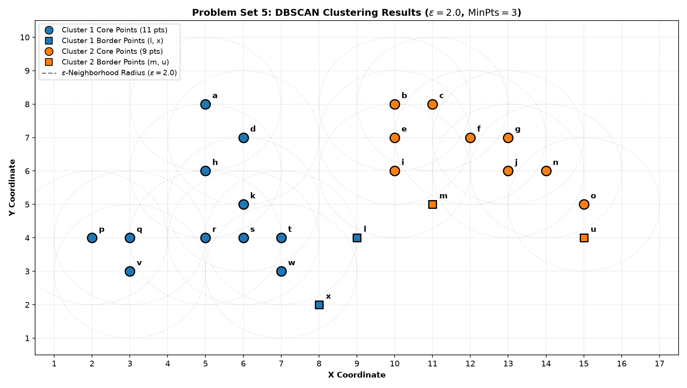
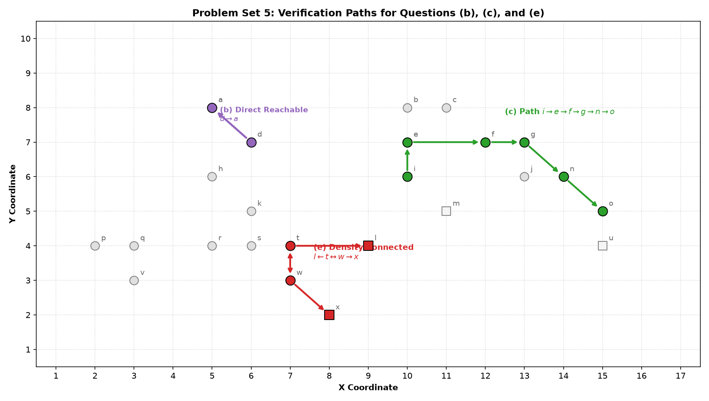

# Problem Set 5: Density-Based Clustering (DBSCAN)

Comprehensive solutions, rigorous theoretical definitions, reproducible code implementations, and step-by-step derivations for **Problem Set 5: Density-Based Clustering (Phân cụm dữ liệu theo mật độ)** (Course: Data Mining - AIT3003).

Reference Textbook: *Data Mining: Concepts and Techniques (3rd Edition)* by Jiawei Han, Micheline Kamber, and Jian Pei (Morgan Kaufmann, 2011, Section 10.4: Density-Based Methods) and Martin Ester et al., *A Density-Based Algorithm for Discovering Clusters in Large Spatial Databases with Noise (KDD-96)*.

---

## Table of Contents
1. [Problem Statement & Formal DBSCAN Definitions](#problem-statement--formal-dbscan-definitions)
2. [Complete Point Coordinates & $\epsilon$-Neighborhood Analysis](#complete-point-coordinates--epsilon-neighborhood-analysis)
3. [Question (a): Core Points Identification](#question-a-core-points-identification)
4. [Question (b): Direct Density-Reachability from $d$ to $a$](#question-b-direct-density-reachability-from-d-to-a)
5. [Question (c): Density-Reachability from $i$ to $o$](#question-c-density-reachability-from-i-to-o)
6. [Question (d): Symmetry of the Density-Reachable Relation](#question-d-symmetry-of-the-density-reachable-relation)
7. [Question (e): Density-Connectivity between $l$ and $x$](#question-e-density-connectivity-between-l-and-x)
8. [Question (f): Symmetry of the Density-Connected Relation](#question-f-symmetry-of-the-density-connected-relation)
9. [Question (g): Final Clusters and Noise Points](#question-g-final-clusters-and-noise-points)
10. [Visualizations & Verification Paths](#visualizations--verification-paths)

---

## Problem Statement & Formal DBSCAN Definitions

> **Prompt:** Xem hình dưới đây và trả lời các câu hỏi sau, giả sử rằng chúng ta sử dụng khoảng cách Euclid giữa các điểm, với $\epsilon = 2$ và $\text{MinPts} = 3$:  
> (a) Liệt kê tất cả các điểm lõi (core points).  
> (b) Liệu điểm $a$ có thể đạt được mật độ trực tiếp (directly density-reachable) từ điểm $d$ không?  
> (c) Liệu điểm $o$ có thể đạt được mật độ (density-reachable) từ điểm $i$ không? Hãy chỉ ra các đối tượng trung gian trên chuỗi hoặc đối tượng nơi chuỗi bị gián đoạn.  
> (d) Liệu quan hệ đạt được mật độ (density-reachable) có tính chất đối xứng hay không, tức là nếu $x$ đạt được mật độ từ $y$, thì điều đó có suy ra rằng $y$ cũng đạt được mật độ từ $x$ không? Tại sao hoặc tại sao không?  
> (e) Liệu điểm $l$ có được kết nối mật độ (density-connected) với điểm $x$ không? Hãy chỉ ra các điểm trung gian khiến chúng được kết nối mật độ hoặc vi phạm tính chất này.  
> (f) Liệu quan hệ kết nối mật độ (density-connected) có tính chất đối xứng không?  
> (g) Xác định các cụm dựa trên mật độ và các điểm nhiễu.

### Fundamental Theoretical Definitions (Han & Kamber, Section 10.4.1):

1. **$\epsilon$-Neighborhood of a point $\mathbf{p}$ ($N_\epsilon(\mathbf{p})$):**
   $$N_\epsilon(\mathbf{p}) = \{ \mathbf{q} \in D \mid \text{dist}(\mathbf{p}, \mathbf{q}) \le \epsilon \}$$
   *(Note: $\mathbf{p}$ itself is always included in $N_\epsilon(\mathbf{p})$).*

2. **Core Point:**
   A point $\mathbf{p}$ is a **core point** if its $\epsilon$-neighborhood contains at least $\text{MinPts}$ points:
   $$|N_\epsilon(\mathbf{p})| \ge \text{MinPts}$$

3. **Directly Density-Reachable:**
   A point $\mathbf{p}$ is **directly density-reachable** from point $\mathbf{q}$ with respect to $\epsilon$ and $\text{MinPts}$ if:
   1. $\mathbf{p} \in N_\epsilon(\mathbf{q})$ (i.e., $\text{dist}(\mathbf{p}, \mathbf{q}) \le \epsilon$), and
   2. $\mathbf{q}$ is a **core point**.

4. **Density-Reachable:**
   A point $\mathbf{p}$ is **density-reachable** from point $\mathbf{q}$ with respect to $\epsilon$ and $\text{MinPts}$ if there exists a chain of points $\mathbf{p}_1, \mathbf{p}_2, \dots, \mathbf{p}_k$ such that:
   - $\mathbf{p}_1 = \mathbf{q}$, $\mathbf{p}_k = \mathbf{p}$, and
   - $\mathbf{p}_{i+1}$ is directly density-reachable from $\mathbf{p}_i$ for each $i \in \{1, \dots, k-1\}$.  
   *(Crucial requirement: All intermediate points $\mathbf{p}_1, \dots, \mathbf{p}_{k-1}$ must be **core points**! The destination $\mathbf{p}_k$ can be either a core point or a border point).*

5. **Density-Connected:**
   A point $\mathbf{p}$ is **density-connected** to a point $\mathbf{q}$ with respect to $\epsilon$ and $\text{MinPts}$ if there exists an object $\mathbf{o} \in D$ such that **both** $\mathbf{p}$ and $\mathbf{q}$ are density-reachable from $\mathbf{o}$.

6. **Density-Based Cluster:**
   A non-empty subset $C \subseteq D$ satisfying:
   - **Maximality:** $\forall \mathbf{p}, \mathbf{q}$: If $\mathbf{p} \in C$ and $\mathbf{q}$ is density-reachable from $\mathbf{p}$, then $\mathbf{q} \in C$.
   - **Connectivity:** $\forall \mathbf{p}, \mathbf{q} \in C$: $\mathbf{p}$ is density-connected to $\mathbf{q}$.

7. **Noise Point:**
   Any point not belonging to any density-based cluster (i.e., neither a core point nor density-reachable from any core point).

---

## Complete Point Coordinates & $\epsilon$-Neighborhood Analysis

There are $N = 24$ points in the dataset. Using the integer grid axes from the problem diagram:

| Point | $(x, y)$ | $|N_\epsilon|$ | Point Type | Points in $N_\epsilon(\mathbf{p})$ with Euclidean Distance $\le \epsilon = 2.0$ |
|:---:|:---:|:---:|:---:|:---|
| **$a$** | $(5, 8)$ | **3** | **CORE** | $a(0.00), \, d(\sqrt{2} \approx 1.41), \, h(2.00)$ |
| **$b$** | $(10, 8)$ | **4** | **CORE** | $b(0.00), \, c(1.00), \, e(1.00), \, i(2.00)$ |
| **$c$** | $(11, 8)$ | **4** | **CORE** | $c(0.00), \, b(1.00), \, e(\sqrt{2} \approx 1.41), \, f(\sqrt{2} \approx 1.41)$ |
| **$d$** | $(6, 7)$ | **4** | **CORE** | $d(0.00), \, a(\sqrt{2} \approx 1.41), \, h(\sqrt{2} \approx 1.41), \, k(2.00)$ |
| **$e$** | $(10, 7)$ | **5** | **CORE** | $e(0.00), \, b(1.00), \, i(1.00), \, c(\sqrt{2} \approx 1.41), \, f(2.00)$ |
| **$f$** | $(12, 7)$ | **5** | **CORE** | $f(0.00), \, g(1.00), \, c(\sqrt{2} \approx 1.41), \, j(\sqrt{2} \approx 1.41), \, e(2.00)$ |
| **$g$** | $(13, 7)$ | **4** | **CORE** | $g(0.00), \, f(1.00), \, j(1.00), \, n(\sqrt{2} \approx 1.41)$ |
| **$h$** | $(5, 6)$ | **5** | **CORE** | $h(0.00), \, d(\sqrt{2} \approx 1.41), \, k(\sqrt{2} \approx 1.41), \, a(2.00), \, r(2.00)$ |
| **$i$** | $(10, 6)$ | **4** | **CORE** | $i(0.00), \, e(1.00), \, m(\sqrt{2} \approx 1.41), \, b(2.00)$ |
| **$j$** | $(13, 6)$ | **4** | **CORE** | $j(0.00), \, g(1.00), \, n(1.00), \, f(\sqrt{2} \approx 1.41)$ |
| **$k$** | $(6, 5)$ | **6** | **CORE** | $k(0.00), \, s(1.00), \, h(\sqrt{2} \approx 1.41), \, r(\sqrt{2} \approx 1.41), \, t(\sqrt{2} \approx 1.41), \, d(2.00)$ |
| **$l$** | $(9, 4)$ | **2** | **Border** | $l(0.00), \, t(2.00)$ |
| **$m$** | $(11, 5)$ | **2** | **Border** | $m(0.00), \, i(\sqrt{2} \approx 1.41)$ |
| **$n$** | $(14, 6)$ | **4** | **CORE** | $n(0.00), \, j(1.00), \, g(\sqrt{2} \approx 1.41), \, o(\sqrt{2} \approx 1.41)$ |
| **$o$** | $(15, 5)$ | **3** | **CORE** | $o(0.00), \, u(1.00), \, n(\sqrt{2} \approx 1.41)$ |
| **$p$** | $(2, 4)$ | **3** | **CORE** | $p(0.00), \, q(1.00), \, v(\sqrt{2} \approx 1.41)$ |
| **$q$** | $(3, 4)$ | **4** | **CORE** | $q(0.00), \, p(1.00), \, v(1.00), \, r(2.00)$ |
| **$r$** | $(5, 4)$ | **6** | **CORE** | $r(0.00), \, s(1.00), \, k(\sqrt{2} \approx 1.41), \, h(2.00), \, q(2.00), \, t(2.00)$ |
| **$s$** | $(6, 4)$ | **5** | **CORE** | $s(0.00), \, k(1.00), \, r(1.00), \, t(1.00), \, w(\sqrt{2} \approx 1.41)$ |
| **$t$** | $(7, 4)$ | **6** | **CORE** | $t(0.00), \, s(1.00), \, w(1.00), \, k(\sqrt{2} \approx 1.41), \, l(2.00), \, r(2.00)$ |
| **$u$** | $(15, 4)$ | **2** | **Border** | $u(0.00), \, o(1.00)$ |
| **$v$** | $(3, 3)$ | **3** | **CORE** | $v(0.00), \, q(1.00), \, p(\sqrt{2} \approx 1.41)$ |
| **$w$** | $(7, 3)$ | **4** | **CORE** | $w(0.00), \, t(1.00), \, s(\sqrt{2} \approx 1.41), \, x(\sqrt{2} \approx 1.41)$ |
| **$x$** | $(8, 2)$ | **2** | **Border** | $x(0.00), \, w(\sqrt{2} \approx 1.41)$ |

---

## Question (a): Core Points Identification

> **(a) Liệt kê tất cả các điểm lõi (core points).**

A point is a core point if $|N_\epsilon(\mathbf{p})| \ge \text{MinPts} = 3$.

- **Danh sách 20 điểm lõi (Core Points):**
  $$\mathbf{Core} = \{a, \, b, \, c, \, d, \, e, \, f, \, g, \, h, \, i, \, j, \, k, \, n, \, o, \, p, \, q, \, r, \, s, \, t, \, v, \, w\}$$
- **Danh sách 4 điểm không phải điểm lõi ($|N_\epsilon| = 2 < 3$, là các điểm biên - Border Points):**
  $$\mathbf{Border} = \{l, \, m, \, u, \, x\}$$

---

## Question (b): Direct Density-Reachability from $d$ to $a$

> **(b) Liệu điểm $a$ có thể đạt được mật độ trực tiếp (directly density-reachable) từ điểm $d$ không?**

- **Trả lời:** **CÓ (YES)**.
- **Chứng minh:**
  1. Điểm $d(6, 7)$ là điểm lõi vì $|N_\epsilon(d)| = |\{a, d, h, k\}| = 4 \ge \text{MinPts} = 3$.
  2. Khoảng cách Euclidean giữa $d$ và $a$:
     $$\text{dist}(d, a) = \sqrt{(6 - 5)^2 + (7 - 8)^2} = \sqrt{1^2 + (-1)^2} = \sqrt{2} \approx 1.4142$$
     Vì $\sqrt{2} \le \epsilon = 2.0$, điểm $a$ nằm trong lân cận $\epsilon$ của $d$ ($a \in N_\epsilon(d)$).
  3. Theo định nghĩa, vì $a \in N_\epsilon(d)$ và $d$ là điểm lõi, **điểm $a$ đạt được mật độ trực tiếp từ điểm $d$**.

---

## Question (c): Density-Reachability from $i$ to $o$

> **(c) Liệu điểm $o$ có thể đạt được mật độ (density-reachable) từ điểm $i$ không? Hãy chỉ ra các đối tượng trung gian trên chuỗi hoặc đối tượng nơi chuỗi bị gián đoạn.**

- **Trả lời:** **CÓ (YES)**.
- **Chứng minh & Chuỗi liên kết trung gian:**
  Tồn tại một chuỗi các điểm kết nối từ $i$ đến $o$ gồm toàn các điểm lõi:
  $$\mathbf{p}_1 = i \longrightarrow \mathbf{p}_2 = e \longrightarrow \mathbf{p}_3 = f \longrightarrow \mathbf{p}_4 = g \longrightarrow \mathbf{p}_5 = n \longrightarrow \mathbf{p}_6 = o$$
  
  Kiểm tra từng bước chuyển tiếp:
  - **Bước 1 ($i \to e$):** $i(10, 6) \to e(10, 7)$, $\text{dist} = 1.0 \le 2.0$, $i$ là điểm lõi ($|N_\epsilon(i)| = 4 \ge 3$).
  - **Bước 2 ($e \to f$):** $e(10, 7) \to f(12, 7)$, $\text{dist} = 2.0 \le 2.0$, $e$ là điểm lõi ($|N_\epsilon(e)| = 5 \ge 3$).
  - **Bước 3 ($f \to g$):** $f(12, 7) \to g(13, 7)$, $\text{dist} = 1.0 \le 2.0$, $f$ là điểm lõi ($|N_\epsilon(f)| = 5 \ge 3$).
  - **Bước 4 ($g \to n$):** $g(13, 7) \to n(14, 6)$, $\text{dist} = \sqrt{1^2 + (-1)^2} = \sqrt{2} \approx 1.414 \le 2.0$, $g$ là điểm lõi ($|N_\epsilon(g)| = 4 \ge 3$).
  - **Bước 5 ($n \to o$):** $n(14, 6) \to o(15, 5)$, $\text{dist} = \sqrt{1^2 + (-1)^2} = \sqrt{2} \approx 1.414 \le 2.0$, $n$ là điểm lõi ($|N_\epsilon(n)| = 4 \ge 3$).
  
  Mọi điểm trung gian $e, f, g, n$ đều là **điểm lõi (core points)**, do đó chuỗi không hề bị gián đoạn.  
  *(Lưu ý: Cũng tồn tại các chuỗi tương đương khác như $i \to e \to f \to j \to n \to o$ hoặc $i \to b \to c \to f \to g \to n \to o$).*

---

## Question (d): Symmetry of the Density-Reachable Relation

> **(d) Liệu quan hệ đạt được mật độ (density-reachable) có tính chất đối xứng hay không, tức là nếu $x$ đạt được mật độ từ $y$, thì điều đó có suy ra rằng $y$ cũng đạt được mật độ từ $x$ không? Tại sao hoặc tại sao không?**

- **Trả lời:** **KHÔNG CÓ TÍNH CHẤT ĐỐI XỨNG (Asymmetric / Not symmetric)**.
- **Giải thích:**
  Theo định nghĩa, để một điểm $\mathbf{p}$ đạt được mật độ từ một điểm $\mathbf{q}$, điểm bắt đầu $\mathbf{q}$ (và tất cả các điểm trung gian) **bắt buộc phải là điểm lõi (core point)**. Điểm đích $\mathbf{p}$ có thể là điểm biên (border point).  
  Nếu $\mathbf{q}$ là điểm lõi và $\mathbf{p}$ là điểm biên nằm trong $N_\epsilon(\mathbf{q})$, thì $\mathbf{p}$ đạt được mật độ từ $\mathbf{q}$. Tuy nhiên, do $\mathbf{p}$ là điểm biên ($|N_\epsilon(\mathbf{p})| < \text{MinPts}$), không có bất kỳ điểm nào có thể đạt được mật độ từ $\mathbf{p}$ (kể cả $\mathbf{q}$).
- **Phản ví dụ cụ thể ngay trong dữ liệu bài toán:**
  - Xét cặp điểm $(w, x)$:
    - $w(7, 3)$ là điểm lõi ($|N_\epsilon(w)| = 4 \ge 3$).
    - $x(8, 2)$ là điểm biên ($|N_\epsilon(x)| = 2 < 3$, không phải điểm lõi).
    - Khoảng cách $\text{dist}(w, x) = \sqrt{1^2 + (-1)^2} = \sqrt{2} \approx 1.414 \le 2.0$.
    - $\implies$ **$x$ đạt được mật độ từ $w$**.
    - Nhưng **$w$ KHÔNG THỂ đạt được mật độ từ $x$**, vì $x$ không phải là điểm lõi nên không thể khởi đầu bất kỳ chuỗi đạt được mật độ nào!
  - *(Tương tự đối với các cặp $(t, l)$, $(i, m)$, hoặc $(o, u)$).*

---

## Question (e): Density-Connectivity between $l$ and $x$

> **(e) Liệu điểm $l$ có được kết nối mật độ (density-connected) với điểm $x$ không? Hãy chỉ ra các điểm trung gian khiến chúng được kết nối mật độ hoặc vi phạm tính chất này.**

- **Trả lời:** **CÓ (YES)**.
- **Chứng minh & Điểm trung gian:**
  Theo định nghĩa, hai điểm $l$ và $x$ được kết nối mật độ nếu tồn tại một đối tượng lõi $\mathbf{o}'$ sao cho **cả $l$ và $x$ đều đạt được mật độ từ $\mathbf{o}'$**.
  
  1. Xét các điểm liên quan:
     - $l(9, 4)$ là điểm biên gắn liền với điểm lõi $t(7, 4)$ vì $\text{dist}(t, l) = 2.0 \le \epsilon$. Do đó $l$ đạt được mật độ từ $t$.
     - $x(8, 2)$ là điểm biên gắn liền với điểm lõi $w(7, 3)$ vì $\text{dist}(w, x) = \sqrt{2} \approx 1.414 \le \epsilon$. Do đó $x$ đạt được mật độ từ $w$.
     - Hai điểm $t(7, 4)$ và $w(7, 3)$ đều là **điểm lõi** và $\text{dist}(t, w) = 1.0 \le \epsilon$. Do đó $w$ đạt được mật độ từ $t$ (và ngược lại).
  2. Chọn điểm lõi chung $\mathbf{o}' = t(7, 4)$ (hoặc $\mathbf{o}' = w(7, 3)$):
     - Từ $t$: $l$ đạt được mật độ từ $t$ qua liên kết trực tiếp $t \to l$.
     - Từ $t$: $x$ đạt được mật độ từ $t$ qua chuỗi $t \to w \to x$ (với $t, w$ là các điểm lõi).
  3. Vì tồn tại điểm lõi $t$ mà cả $l$ và $x$ đều đạt được mật độ từ đó, nên **$l$ và $x$ được kết nối mật độ**.
  
  - **Chuỗi liên kết mật độ trung gian:**
    $$l \longleftarrow t \longleftrightarrow w \longrightarrow x$$
    Các điểm trung gian: Điểm lõi $t(7, 4)$ và điểm lõi $w(7, 3)$.

---

## Question (f): Symmetry of the Density-Connected Relation

> **(f) Liệu quan hệ kết nối mật độ (density-connected) có tính chất đối xứng không?**

- **Trả lời:** **CÓ TÍNH CHẤT ĐỐI XỨNG (Symmetric)**.
- **Chứng minh:**
  Theo định nghĩa hình thức:
  $$\mathbf{p} \text{ kết nối mật độ với } \mathbf{q} \iff \exists \mathbf{o}' \in D \text{ sao cho } \mathbf{p} \text{ và } \mathbf{q} \text{ đều đạt được mật độ từ } \mathbf{o}'$$
  Mệnh đề logic "$\mathbf{p}$ và $\mathbf{q}$ đều đạt được mật độ từ $\mathbf{o}'$" hoàn toàn tương đương với "$\mathbf{q}$ và $\mathbf{p}$ đều đạt được mật độ từ $\mathbf{o}'$".  
  Do hai đối tượng $\mathbf{p}$ và $\mathbf{q}$ có vai trò bình đẳng và đối xứng tuyệt đối trong định nghĩa, nên:
  $$\mathbf{p} \text{ kết nối mật độ với } \mathbf{q} \iff \mathbf{q} \text{ kết nối mật độ với } \mathbf{p}$$
  Do đó quan hệ kết nối mật độ luôn có tính chất đối xứng.

---

## Question (g): Final Clusters and Noise Points

> **(g) Xác định các cụm dựa trên mật độ và các điểm nhiễu.**

Thuật toán DBSCAN với $\epsilon = 2.0$ và $\text{MinPts} = 3$ phân hoạch toàn bộ $24$ điểm thành **2 cụm** riêng biệt và **không có điểm nhiễu**:

### 1. Cụm 1 (Cluster 1) - Nhóm điểm phía bên trái:
- **Tổng số điểm:** $13$ điểm.
- **Thành phần:**
  - **11 điểm lõi:** $\{a, \, d, \, h, \, k, \, p, \, q, \, r, \, s, \, t, \, v, \, w\}$
  - **2 điểm biên:** $\{l, \, x\}$ (trong đó $l$ là điểm biên của $t$; $x$ là điểm biên của $w$).
- **Tập hợp đầy đủ:**
  $$\mathbf{C}_1 = \{a, \, d, \, h, \, k, \, l, \, p, \, q, \, r, \, s, \, t, \, v, \, w, \, x\}$$

### 2. Cụm 2 (Cluster 2) - Nhóm điểm phía bên phải:
- **Tổng số điểm:** $11$ điểm.
- **Thành phần:**
  - **9 điểm lõi:** $\{b, \, c, \, e, \, f, \, g, \, i, \, j, \, n, \, o\}$
  - **2 điểm biên:** $\{m, \, u\}$ (trong đó $m$ là điểm biên của $i$; $u$ là điểm biên của $o$).
- **Tập hợp đầy đủ:**
  $$\mathbf{C}_2 = \{b, \, c, \, e, \, f, \, g, \, i, \, j, \, m, \, n, \, o, \, u\}$$

### 3. Điểm nhiễu (Noise Points):
- **Tập rỗng $\emptyset$ (Không có điểm nhiễu).**
- *Lý do:* Cả 4 điểm không phải điểm lõi ($l, m, u, x$) đều nằm trong lân cận $\epsilon$ của ít nhất một điểm lõi ($l \in N_\epsilon(t)$, $m \in N_\epsilon(i)$, $u \in N_\epsilon(o)$, $x \in N_\epsilon(w)$), do đó tất cả chúng đều là điểm biên hợp lệ của các cụm tương ứng.

### 4. Tại sao Cụm 1 và Cụm 2 không hợp nhất thành một cụm duy nhất?
- Khoảng cách giữa điểm cực phải của Cụm 1 là $l(9, 4)$ tới các điểm gần nhất của Cụm 2:
  - $\text{dist}(l(9, 4), i(10, 6)) = \sqrt{1^2 + 2^2} = \sqrt{5} \approx 2.236 > 2.0$
  - $\text{dist}(l(9, 4), m(11, 5)) = \sqrt{2^2 + 1^2} = \sqrt{5} \approx 2.236 > 2.0$
- Hơn nữa, cả $l$ và $m$ đều là **điểm biên (border points)** chứ không phải điểm lõi, nên theo nguyên lý mật độ, chuỗi mật độ không thể truyền qua các điểm biên để nối liền hai cụm. Hai cụm hoàn toàn cách ly về mật độ.

---

## Visualizations & Verification Paths

### Biểu đồ phân cụm DBSCAN

### Sơ đồ chuỗi kiểm tra tiếp cận mật độ và kết nối mật độ

